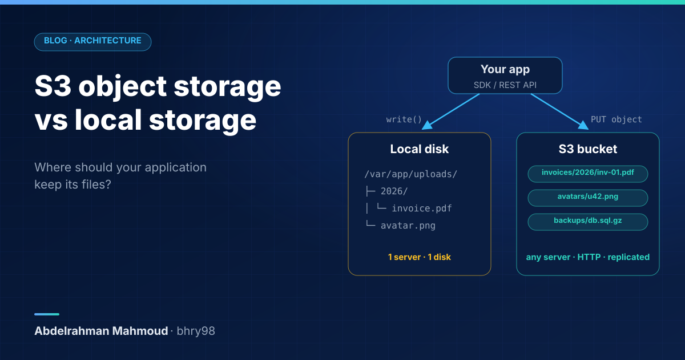

# What Is S3 Storage? S3 vs Local Storage for Your Applications



Your application lets users upload invoices and profile pictures. The easy solution is to save them
in a folder like `/var/app/uploads`. It works perfectly, until you add a second server, move to
containers, or lose the disk. This post explains **S3 object storage**, how it differs from local
storage, and how to choose.

<!-- more -->

## What is S3?

**Amazon S3 (Simple Storage Service)** launched in 2006 as a service to store files over HTTP. Its
API became so popular that "S3" now also means **a protocol**: dozens of products, cloud and
on-premises, speak the same **S3 API**. Your code doesn't care whether it talks to AWS, MinIO in
your data centre, or Ceph on OpenShift.

S3 is **object storage**:

| Term | Meaning | Example |
|---|---|---|
| **Bucket** | A top-level container with its own permissions and settings | `orders-documents` |
| **Object** | A file plus its metadata, stored as one unit | the PDF bytes + `Content-Type: application/pdf` |
| **Key** | The object's unique name inside the bucket | `invoices/2026/11/inv-1042.pdf` |
| **Metadata** | Key/value info attached to an object | `x-amz-meta-customer-id: 42` |

There are no real folders: `invoices/2026/` is just a key prefix that consoles display as a folder.
You don't open, seek and append to objects like files; you **PUT** a whole object, **GET** it back,
or **DELETE** it, over HTTPS.

```bash
aws s3 mb s3://orders-documents
aws s3 cp inv-1042.pdf s3://orders-documents/invoices/2026/11/inv-1042.pdf
aws s3 ls s3://orders-documents/invoices/2026/11/
```

## The three kinds of storage

| | **Block storage** | **File storage** | **Object storage (S3)** |
|---|---|---|---|
| Looks like | A raw disk (`/dev/sdb`) | A shared folder (NFS, SMB) | Buckets of objects over HTTP |
| Examples | Local SSD, SAN, AWS EBS, VMware VMDK | NFS, Windows file share, AWS EFS | AWS S3, MinIO, Ceph RGW, Azure Blob* |
| Access | One server at a time (mounted) | Many servers via a mount | Any client, anywhere, via API |
| Edit part of a file | Yes | Yes | No, replace the whole object |
| Scale | One volume's size | One file server/cluster | Practically unlimited |
| Best for | Databases, OS disks | Legacy apps sharing files | Uploads, backups, media, logs, data lakes |

\*Azure Blob and Google Cloud Storage have their own APIs, with S3-compatible options/gateways.

## Local storage vs S3 for your application

### Local storage (disk on the app server)

```java
Path target = Path.of("/var/app/uploads", fileName);
Files.copy(upload.getInputStream(), target);
```

- :material-check: Simple, fast, no extra service, works offline.
- :material-close: **Tied to one server.** Add a second instance behind a load balancer and half of
  the users get `404` for files saved on the other node.
- :material-close: **Containers lose it.** A pod's filesystem disappears on restart unless you add a
  persistent volume, and a `ReadWriteOnce` volume blocks scaling to many replicas.
- :material-close: Backup, replication, encryption and lifecycle are your job.
- :material-close: The disk fills up at 3 a.m.

### S3 object storage

```java
s3.putObject(PutObjectRequest.builder()
        .bucket("orders-documents")
        .key("invoices/2026/11/inv-1042.pdf")
        .contentType("application/pdf")
        .build(),
    RequestBody.fromInputStream(upload.getInputStream(), upload.getSize()));
```

- :material-check: **Stateless apps.** Any instance can read any file, so you can scale horizontally and
  restart pods freely. This is exactly what [containers and Kubernetes](../devops/containers-vs-traditional-deployment.md) need.
- :material-check: **Durability.** Data is replicated across disks/servers/zones (AWS advertises
  99.999999999% durability).
- :material-check: **Built-in features:** versioning, encryption at rest, lifecycle rules (move to cheaper
  storage, delete after N days), object lock for compliance, replication between sites.
- :material-check: **Pre-signed URLs:** let browsers upload/download directly with a time-limited link, so
  big files never pass through your app server.
- :material-close: Network latency on every access; not suitable for random-access workloads like databases.
- :material-close: No partial updates or file locking; "rename" is copy + delete.
- :material-close: Costs: storage, requests and especially **egress** (data out) in public clouds.

### Side-by-side

| Question | **Local disk** | **S3** |
|---|---|---|
| Multiple app instances share files? | No (needs NFS) | Yes |
| Survives server/pod loss? | Only with backups/RAID | Yes, replicated |
| Max capacity | Disk size | Practically unlimited |
| Latency | Microseconds | Milliseconds |
| Serve files directly to users | Through your app or Nginx | Pre-signed URL / CDN |
| Versioning & retention | DIY | Built in |
| Running cost | Hardware you already have | Per GB + requests (+ egress) |
| Good for | Temp files, caches, single-server apps, databases | User uploads, documents, media, backups, logs, exports |

## S3-compatible products

| Product | Where it runs | Notes |
|---|---|---|
| **AWS S3** | AWS | The original; storage classes from Standard to Glacier Deep Archive |
| **MinIO** | Anywhere (binary, Docker, Kubernetes) | Very popular for on-prem and dev environments |
| **Ceph RGW** | On-prem clusters | Also provides block and file storage |
| **OpenShift Data Foundation** | OpenShift | Ceph + NooBaa, gives buckets via `ObjectBucketClaim` |
| **Cloudflare R2, Wasabi, Backblaze B2** | Cloud | S3 API, low or zero egress fees |
| **Google Cloud Storage / Azure Blob** | GCP / Azure | Native APIs; S3 interoperability options |

Try it locally in one command:

```bash
docker run -d --name minio -p 9000:9000 -p 9001:9001 \
  -e MINIO_ROOT_USER=admin -e MINIO_ROOT_PASSWORD=change-me-please \
  quay.io/minio/minio server /data --console-address ":9001"
```

Open <http://localhost:9001>, create a bucket, and point your app's S3 client at
`http://localhost:9000` with *path-style* access enabled.

## Good practices

1. **Store the key in your database, not the file.** Keep `invoices/2026/11/inv-1042.pdf` in the
   `invoice` table; never put binary files in the DB.
2. **Keep buckets private.** Serve downloads with short-lived **pre-signed URLs** or through a
   CDN, never by making the bucket public.
3. **Use least-privilege credentials** per application (one bucket, only the actions it needs), and
   IAM roles / workload identity instead of static keys where possible.
4. **Turn on versioning and lifecycle rules** for important data, plus encryption at rest.
5. **Make the endpoint configurable** (`S3_ENDPOINT`, `S3_BUCKET`), so the same code works with MinIO in
   dev and AWS or Ceph in production.

## When local storage is still right

- Databases, message brokers and search indexes (they need block storage).
- Temporary processing files you delete after the request.
- A single-server internal tool with a solid backup.
- Caches that can be rebuilt.

## Takeaway

Local disk is a **place on one server**; S3 is a **service any server can reach**. If your
application keeps user files and you ever want more than one instance, containers, or real
durability, put those files in S3-compatible object storage and keep only temporary data locally.

Related: [Containers vs traditional deployment](../devops/containers-vs-traditional-deployment.md) ·
[What is Nginx?](../infrastructure/what-is-nginx.md) (it can proxy and cache S3/MinIO downloads too)
