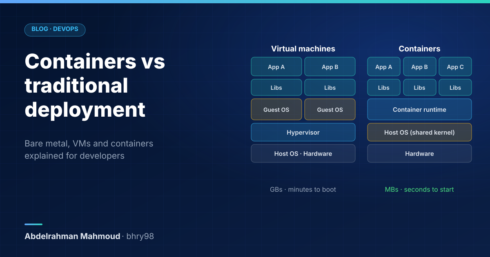

# Understanding Containers: Containers vs Traditional Deployment



"It works on my machine" is probably the most expensive sentence in software. Containers exist to
make sure that what works on your machine works the same way in test and production. This post
explains what a container actually is, how it differs from installing apps on servers or virtual
machines, and when each approach makes sense.

<!-- more -->

## Three ways to run an application

### 1. Bare metal: install directly on a server

You install Java, Nginx, the app and its libraries straight onto the operating system of a
physical server.

- :material-check: Maximum performance, nothing in between.
- :material-close: One server = usually one purpose; scaling means buying hardware.
- :material-close: Apps share the same libraries; upgrading Java for one app can break another.
- :material-close: Servers drift: after two years nobody knows exactly what is installed.

### 2. Virtual machines (VMs)

A **hypervisor** (VMware ESXi, KVM, Hyper-V) splits one physical server into many virtual ones.
Each VM runs a **full guest operating system** with its own kernel.

- :material-check: Strong isolation, run Windows and Linux side by side.
- :material-check: Snapshots, live migration, better hardware use.
- :material-close: Each VM carries a whole OS: gigabytes of disk, RAM for the kernel, minutes to boot,
  and one more OS to patch.

### 3. Containers

A **container** packages the application **with everything it needs** (runtime, libraries, config
defaults) into an **image**, and runs it as an **isolated process** on a shared Linux kernel. No
guest OS, no hypervisor.

- :material-check: Megabytes instead of gigabytes; starts in seconds.
- :material-check: The same image runs on a laptop, in CI, in test and in production.
- :material-check: Dozens of containers per host, each with its own dependencies.
- :material-close: Weaker isolation than VMs (shared kernel), and you need new skills and tools.

## What a container really is

A container is **not** a small VM. It is a normal Linux process with three kernel features around it:

| Feature | What it does |
|---|---|
| **Namespaces** | Give the process its own view of PIDs, network, mounts, hostname and users, so it thinks it is alone on the machine |
| **cgroups** | Limit and measure CPU, memory and I/O (this is what `--memory=512m` uses) |
| **Union / overlay filesystem** | Stack read-only image layers plus a thin writable layer on top |

You can see this yourself: run a container and look for its process on the host.

```bash
docker run -d --name web nginx:stable-alpine
ps aux | grep "nginx: master"      # it's just a process on the host
```

### Images vs containers

- An **image** is a read-only template, built from a `Dockerfile`, stored in a **registry**
  (Docker Hub, Quay, GHCR, Nexus, Harbor).
- A **container** is a running instance of an image. You can start ten containers from one image.

```dockerfile title="Dockerfile"
FROM eclipse-temurin:21-jre          # base image: OS libraries + Java runtime
WORKDIR /app
COPY target/orders-api.jar app.jar   # your application
EXPOSE 8080
USER 1001                            # don't run as root
ENTRYPOINT ["java", "-jar", "app.jar"]
```

```bash
docker build -t orders-api:1.0 .
docker run -d -p 8080:8080 orders-api:1.0
```

That image now contains *exactly* Java 21 and your JAR, on any host that has a container runtime.
(Not sure what JRE means here? See [JDK vs JRE vs JVM](../java/jdk-vs-jre-vs-jvm.md).)

## Side-by-side comparison

| | **Bare metal** | **Virtual machine** | **Container** |
|---|---|---|---|
| Isolation unit | Physical server | Full OS with own kernel | Process with namespaces |
| Size | Whole server | GBs | MBs to a few hundred MBs |
| Start time | Minutes (boot) | Minutes | Seconds or less |
| Density per host | 1 | Tens | Hundreds |
| Isolation strength | Physical | Strong (hardware virtualization) | Good, shared kernel |
| Portability | Low | Medium (image formats differ) | High (OCI standard) |
| Config drift | High | Medium | Low (immutable images) |
| OS patching | Per server | Per VM | Rebuild the image from an updated base |
| Run Windows apps on Linux host | No | Yes | No (containers share the host kernel type) |

## Containers in production: orchestration

One container on a laptop is easy. Hundreds across many servers need an **orchestrator** that
schedules containers, restarts them when they crash, scales them, and routes traffic:

- **Kubernetes**: the industry standard.
- **Red Hat OpenShift**: Kubernetes with security, routing, registry and CI built in
  (see [OpenShift is not just Kubernetes](../openshift/openshift-vs-kubernetes.md)).
- **Docker Compose**: for a single host, development and small setups.

Containers also change how apps should behave. They should be **stateless** (keep files in object
storage, not on local disk: see [S3 vs local storage](../architecture/s3-object-storage-vs-local-storage.md)),
read config from **environment variables**, log to **stdout**, and expose **health checks**.

## Common myths

- **"Containers are lightweight VMs."** No kernel, no boot, no hypervisor: they are processes.
- **"Containers are secure by default."** Not if you run them as root with every capability. Use
  non-root users, minimal base images and image scanning. OpenShift enforces much of this.
- **"Docker = containers."** Docker popularised them, but images follow the open **OCI** standard;
  Podman, containerd and CRI-O run the same images.
- **"Containers replace VMs."** In most companies, containers run **on** VMs. They solve different
  problems and work well together.

## When traditional deployment is still the right call

- Legacy apps that expect a full OS, hard-coded paths, or GUI access.
- Heavy, stateful databases where a dedicated, tuned VM is simpler to operate.
- Windows desktop software or licences tied to a machine.
- Very small teams with one or two stable apps and no appetite for an orchestrator.

## Takeaway

Bare metal gives raw power, VMs give strong isolation, and containers give **speed, density and
"build once, run anywhere"**. For new services and APIs, containers on Kubernetes or OpenShift are
the default today; for legacy and heavy stateful systems, a well-managed VM is still a fine answer.

Try it yourself: run Nginx in a container with the Docker option of
[How to install Nginx](../../../how-to/nginx/install-nginx.md).
