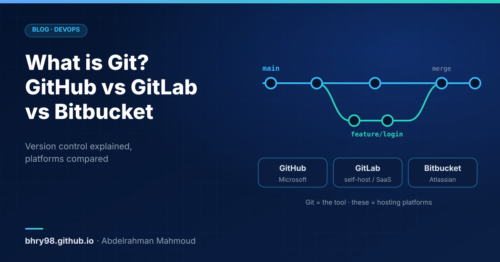
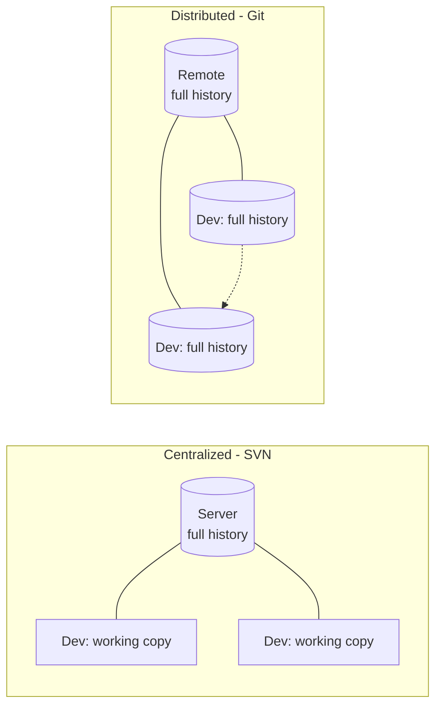

# What Is Git? And GitHub vs GitLab vs Bitbucket (and Others) Compared



Every developer uses Git, but many people mix up **Git** (the tool) and **GitHub** (a website that
hosts Git repositories). This post explains what Git is and why it won, then compares the
platforms built around it so you can choose the right one for your team.

<!-- more -->

## What is version control?

Without version control, projects end up like this:

```text
report-final.docx
report-final-v2.docx
report-final-v2-ahmed-fixes.docx
report-final-REALLY-final.docx
```

A **version control system (VCS)** records every change to your files: **who** changed **what**,
**when** and **why**. You can go back to any earlier version, see exactly what changed between two
versions, and let several people work on the same code without overwriting each other.

## What is Git?

**Git** is a free, open-source, **distributed** version control system. Linus Torvalds wrote it in
2005 to manage the Linux kernel source code, and it is now used by almost every software team.

"Distributed" is the key word. With older, centralized systems (SVN, TFVC, CVS) the history lives
on one server, so you need that server to commit or look at history. With Git, **every clone is a
full copy of the repository with its entire history**. You can commit, branch, diff and read logs
offline, and push to a shared server when you are ready.



## Why we use Git

- **History and blame.** `git log` and `git blame` tell you why a line exists, which is gold when
  debugging a production issue a year later.
- **Branches are cheap.** Creating a branch takes milliseconds, so every feature, fix or experiment
  gets its own branch, and `main` stays stable.
- **Safe collaboration.** Merges and pull/merge requests let teams review code before it lands.
- **Undo almost anything.** Revert a bad commit, restore a deleted file, or find the commit that
  introduced a bug with `git bisect`.
- **It drives automation.** CI/CD pipelines, GitOps (Argo CD, Flux) and infrastructure as code all
  start from a Git push.
- **Speed and integrity.** Most operations are local; every commit is identified by a hash of its
  content, so history can't be silently corrupted.

## The core ideas in five minutes

| Concept | What it means |
|---|---|
| **Repository** | A project folder plus its full history (the hidden `.git` folder) |
| **Working tree → Staging area → Commit** | Edit files, choose what to include with `git add`, save a snapshot with `git commit` |
| **Commit** | A snapshot with an author, date, message and a unique SHA hash |
| **Branch** | A movable pointer to a commit (`main`, `feature/login`) |
| **Merge / Rebase** | Two ways to combine the work of two branches |
| **Remote** | Another copy of the repo, usually on GitHub/GitLab (`origin`) |
| **Push / Pull / Fetch** | Send commits to a remote, or get commits from it |
| **Pull Request / Merge Request** | A platform feature (not Git itself) to review and discuss a branch before merging |

A typical day:

```bash
git switch -c feature/login        # new branch
# ...edit code...
git add src/LoginController.java
git commit -m "Add login endpoint"
git push -u origin feature/login   # then open a Pull/Merge Request
```

## Git vs GitHub: the important difference

**Git is the tool. GitHub, GitLab and Bitbucket are services that host Git repositories** and add
collaboration features around them: web UI, pull requests, code review, issues, CI/CD, permissions,
security scanning. Your repository works the same way with any of them, so you can move a repo
from one to another with a single `git push --mirror`.

## The platforms compared

### GitHub

The largest platform (owned by Microsoft), home of most open-source projects.

- **Strengths:** biggest community, **GitHub Actions** CI/CD with a huge marketplace, Copilot,
  Dependabot, code scanning, Codespaces, GitHub Pages (this site runs on it).
- **Self-hosted:** yes, **GitHub Enterprise Server** (paid).
- **Best for:** open source, public portfolios, teams that want the richest ecosystem.

### GitLab

A complete **DevSecOps platform** in one application, with an open-source core.

- **Strengths:** built-in CI/CD that many consider the best integrated pipeline engine, a container
  registry, package registry, security scanning, issue boards, environments. The **free
  Community Edition can be self-hosted**.
- **Self-hosted:** yes, free (CE) or paid (EE). Very common in banks and government on-prem.
- **Best for:** companies that must keep code on their own servers, or want one tool from commit to
  deploy.

### Bitbucket

Atlassian's Git hosting, tightly connected to **Jira** and **Confluence**.

- **Strengths:** Jira integration (branches and commits linked to tickets), **Bitbucket Pipelines**.
- **Self-hosted:** **Bitbucket Data Center** (Server edition reached end of life in 2024).
- **Best for:** teams already using Jira and Confluence.

### Others worth knowing

- **Azure DevOps Repos**: part of Azure DevOps (Boards, Pipelines, Artifacts); common in Microsoft-centric enterprises.
- **Gitea / Forgejo**: lightweight, open-source, self-hosted. A single binary that runs on a Raspberry Pi.
- **AWS CodeCommit**: AWS closed it to new customers in 2024, so don't start new projects on it.
- **Gerrit**: code review focused, used by Android and other large projects.

### Comparison table

| | **GitHub** | **GitLab** | **Bitbucket** | **Azure DevOps** | **Gitea / Forgejo** |
|---|---|---|---|---|---|
| Owner | Microsoft | GitLab Inc. | Atlassian | Microsoft | Community |
| Free private repos | Yes | Yes | Yes (small teams) | Yes (5 users) | Yes (self-host) |
| Built-in CI/CD | GitHub Actions | GitLab CI/CD | Pipelines | Azure Pipelines | Gitea/Forgejo Actions |
| Self-hosted option | Enterprise Server (paid) | CE free / EE paid | Data Center (paid) | Azure DevOps Server | Free, open source |
| Container registry | Yes (GHCR) | Yes | No (use another) | Azure Artifacts / ACR | Yes |
| Issue tracking | Issues, Projects | Issues, Epics, Boards | Jira | Azure Boards | Issues |
| Review name | Pull Request | Merge Request | Pull Request | Pull Request | Pull Request |
| Open source itself | No | Core (CE) yes | No | No | Yes |
| Strongest at | Community, ecosystem, AI tools | All-in-one DevSecOps, on-prem | Jira integration | Microsoft stack | Small, simple, self-hosted |

## How to choose

- **Open source or personal portfolio?** → GitHub.
- **Code must stay on your own servers (bank, government, telecom)?** → GitLab self-managed
  (or GitHub Enterprise Server if budget allows).
- **Your company lives in Jira?** → Bitbucket, or GitHub/GitLab with the Jira integration.
- **Microsoft / Azure enterprise?** → Azure DevOps or GitHub Enterprise.
- **Home lab or small team on a tiny server?** → Gitea or Forgejo.

Whichever you pick, the skills transfer: it is all **Git** underneath.

## Takeaway

Git gives you history, branching and safe collaboration; the platforms add the web, the reviews and
the automation around it. Learn Git well first, and switching platforms later is just a remote URL.

Next: [How to install Git](../../../how-to/git/install-git.md) on Windows, macOS and Linux and set
it up properly in five minutes.
