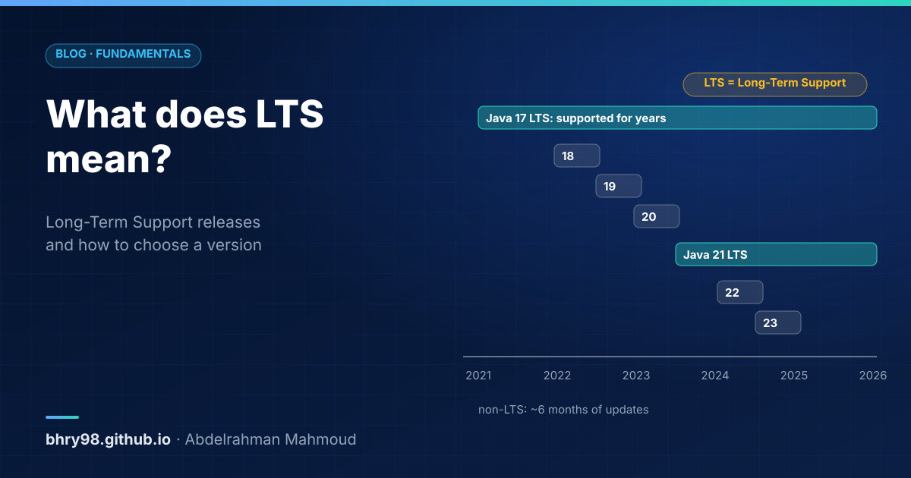
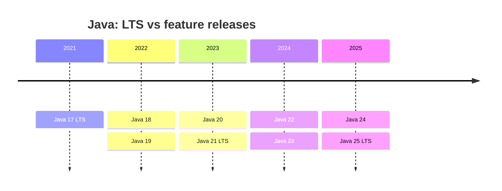

# What Does LTS Mean? Long-Term Support Explained

You go to download Java, Node.js or Ubuntu and there are two big buttons: one says **LTS**, the
other has a higher version number. Which one should you pick? This post explains what LTS means,
why it exists, and how to choose a version for production systems.

<!-- more -->

## LTS in one sentence

**LTS (Long-Term Support) is a release that the vendor promises to maintain with security and bug
fixes for a long, published period (usually years), without adding breaking changes.**

Regular releases (often called *feature*, *current*, *interim* or *mainline*) get new features
first, but are only supported until the next release comes out, often just a few months later.

## Why LTS exists

Upgrading software in a company is expensive: test, certify, schedule downtime, update
documentation, retrain people. Banks, governments and hospitals can't do that every six months.

LTS gives them a deal: *"Stay on this version for years. We'll keep it secure and stable. You
upgrade when you're ready, from one LTS to the next."*

## LTS vs non-LTS

| | **LTS release** | **Regular / feature release** |
|---|---|---|
| Support period | Years (2 to 10+) | Until the next release (weeks to months) |
| Updates | Security and bug fixes only | New features + fixes |
| Stability | High, battle-tested | Newest, less proven |
| Upgrade pressure | Low | Must upgrade often to stay supported |
| Vendor/tool certification | Usually certified | Often not |
| Best for | Production, enterprise | Trying new features, dev, hobby projects |

## Real-world examples

| Product | LTS scheme | Examples |
|---|---|---|
| **Java (OpenJDK)** | A feature release every 6 months; **every 2 years one is LTS** | 8, 11, 17, **21**, **25** are LTS; 22, 23, 24 are not |
| **Ubuntu** | Every 2 years in April (`YY.04`); 5 years standard support, up to 12 with Ubuntu Pro | 22.04 LTS, **24.04 LTS**; 24.10 and 25.04 are interim (9 months) |
| **Node.js** | **Even** major versions become LTS; odd ones never do | 20, **22**, **24** LTS; 23 and 25 are "Current" only |
| **Windows Server** | **LTSC** (Long-Term Servicing Channel): 5 years mainstream + 5 extended | Windows Server 2022, **Windows Server 2025** |
| **RHEL** | Each major version supported for ~10 years | RHEL 8, **RHEL 9**, RHEL 10 |
| **Nginx** | **Stable** (even minor) vs **mainline** (odd minor): same idea, different name | 1.28 stable, 1.29 mainline |
| **Kubernetes** | No LTS: each minor version supported ~14 months; vendors (OpenShift EUS, AKS LTS) add longer support | OpenShift **EUS** releases (even minors) |
| **Spring Boot** | No "LTS" label: open-source support ~13 months per minor; commercial support longer | Plan regular minor upgrades |

!!! warning "Always check the date, not just the label"
    "LTS" doesn't mean forever. Java 8 and Ubuntu 18.04 were LTS too, and now they are past their
    free support. Look up the **end-of-life (EOL)** date. <https://endoflife.date> is a great
    one-stop reference.

## Support phases you will see

Many vendors split LTS into phases:

1. **Active / mainstream support**: bug fixes, security fixes, sometimes small improvements.
2. **Maintenance / extended support**: critical security fixes only, sometimes paid.
3. **End of life (EOL)**: no more fixes. Running it means accepting known, unpatched vulnerabilities,
   and usually failing security audits.

## How I choose a version for production

1. **Default to the latest LTS** that your frameworks and tools support (e.g. Java 21 or 25 with
   Spring Boot 3.x, Node.js 22/24, Ubuntu 24.04, RHEL 9/10, Windows Server 2025).
2. **Check the ecosystem.** Is your app server, database driver, monitoring agent or vendor
   product certified on it?
3. **Avoid a brand-new LTS on day one** for critical systems; wait for the first few patch releases.
4. **Plan the next upgrade now.** Put the EOL date in the team calendar and upgrade one LTS to the
   next well before it.
5. **Keep patching inside the LTS.** LTS isn't "install and forget": apply its updates
   (`21.0.4 → 21.0.9`) regularly; that's the whole point.

Use non-LTS releases for learning, side projects, or when you truly need a new feature and can
commit to upgrading every few months.

## Takeaway

LTS is a promise of **stability and security for a known period**. For anything that runs your
business, pick the current LTS, keep it patched, and know its end-of-life date.

Related reading:

- [JDK vs JRE vs JVM](../java/jdk-vs-jre-vs-jvm.md): which Java to install, and why LTS matters there
- [How to install Nginx](../../../how-to/nginx/install-nginx.md): choosing between *stable* and *mainline*
- [Secure Active Directory with LDAPS on Windows Server 2025](../../../how-to/active-directory/enable-ldaps-active-directory.md): an LTSC release in action
