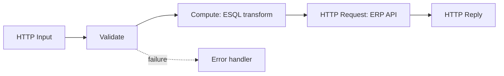

# IBM App Connect Enterprise in practice

**IBM App Connect Enterprise (ACE)**, the successor of IBM Integration Bus, is the integration engine
inside IBM Cloud Pak for Integration. It connects systems that were never designed to talk to each
other: an ERP, a REST API, a message queue, a file drop, a partner's SOAP service.

This is the mental model I wish I'd had on day one.

<!-- more -->

## The building blocks

| Concept | What it is |
|---|---|
| **Message flow** | A graph of nodes: an input, some processing, one or more outputs. |
| **Application / REST API project** | A deployable unit that groups flows, maps and ESQL. |
| **Library / shared library** | Reusable code and schemas shared by several applications. |
| **BAR file** | The packaged, deployable archive (Broker ARchive). |
| **Integration server** | The runtime process that runs your deployed applications. |
| **Policy** | Externalized configuration: endpoints, credentials, MQ connections. |

A typical flow looks like this:



## Transforming messages with ESQL

The **Compute** node runs ESQL, ACE's language for reading and building message trees. Here a
JSON order from a client is reshaped for a back-end system:

```sql
CREATE COMPUTE MODULE TransformOrder_Compute
  CREATE FUNCTION Main() RETURNS BOOLEAN
  BEGIN
    SET OutputRoot.Properties = InputRoot.Properties;

    SET OutputRoot.JSON.Data.orderNumber = InputRoot.JSON.Data.id;
    SET OutputRoot.JSON.Data.customerName = InputRoot.JSON.Data.customer.name;
    SET OutputRoot.JSON.Data.total = CAST(InputRoot.JSON.Data.amount AS DECIMAL);

    RETURN TRUE;
  END;
END MODULE;
```

For mapping-heavy work, the graphical **Mapping node** is often easier to maintain. I use ESQL when
the logic has conditions, loops or lookups.

## Build and deploy from the command line

ACE 12 ships the `ibmint` tool, which makes builds scriptable and CI/CD friendly:

```bash
# Package an application into a BAR file
ibmint package --input-path ./workspace --project OrdersApp \
  --output-bar-file ./build/orders.bar

# Deploy it into an independent integration server's work directory
ibmint deploy --input-bar-file ./build/orders.bar \
  --output-work-directory /home/aceuser/ace-server
```

The same BAR file is then promoted through every environment, the same way you would promote a
container image.

## Keep configuration out of the code

Endpoints, credentials and connection details belong in **policies**, not hard-coded in flows. On
Cloud Pak for Integration, policies and credentials are supplied as *configurations* attached to
the integration runtime. The same BAR then runs in development, test and production with only the
configuration changing.

## Lessons from production

- **Design the contract first.** Agree on the request, response and error formats before building
  the flow.
- **Handle errors deliberately.** Wire the failure and catch terminals; never let a message
  disappear silently.
- **Log a correlation ID** at every hop so one transaction can be traced across systems.
- **Keep flows small.** Several focused flows are easier to test and operate than one huge flow.

Connecting systems in your organization? [Let's talk](../../portfolio/contact.md).
