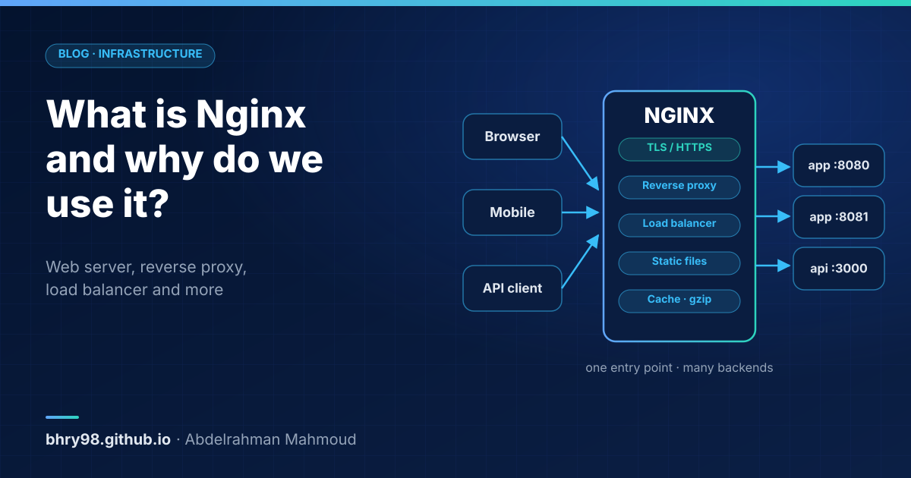
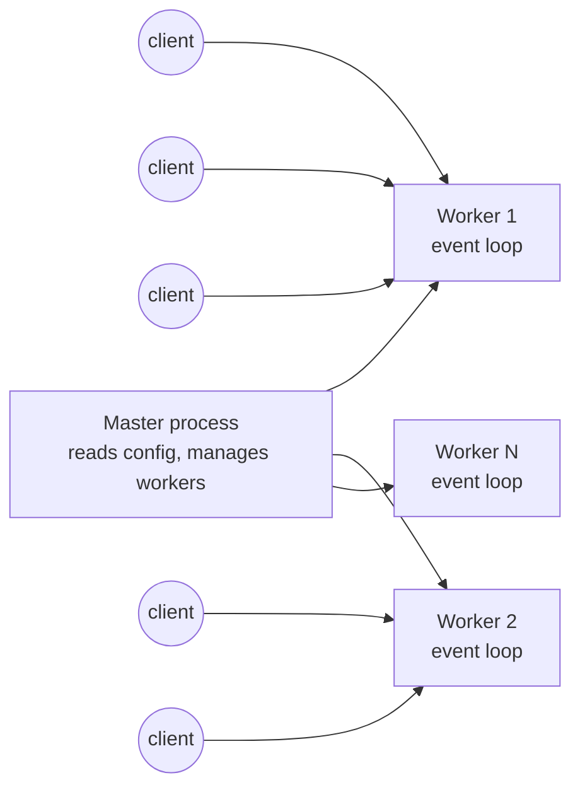
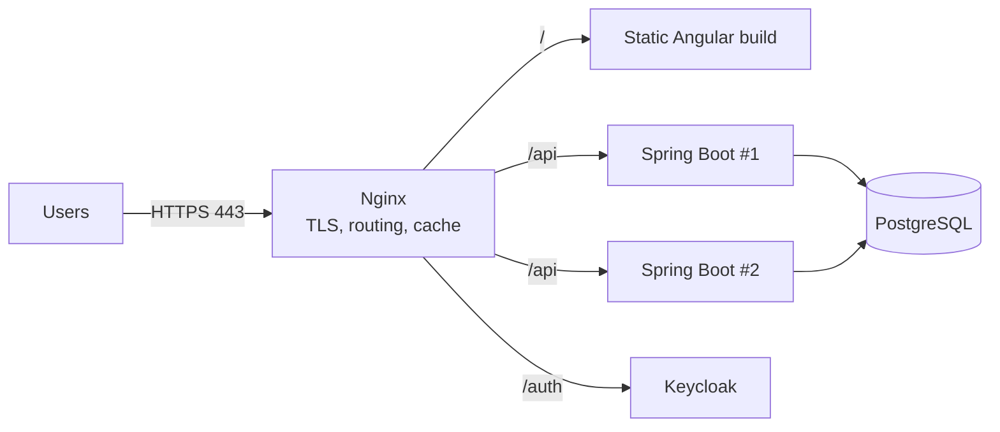

# What Is Nginx and Why Do We Use It?



If you open the HTTP response headers of a random website, there is a good chance you will see
`Server: nginx`. Nginx (pronounced *"engine-x"*) sits in front of a huge share of the web. This
post explains what it is, what problems it solves and why it is usually the first thing a request
hits in a production stack.

<!-- more -->

## Nginx in one sentence

**Nginx is a small, fast, event-driven server that accepts HTTP(S) connections and decides what to
do with them:** serve a file, pass the request to an application, spread it across several
servers, cache the answer, or reject it.

It was written by Igor Sysoev in 2004 to solve the **C10k problem**: how to handle ten thousand
concurrent connections on a single machine. Today it comes in two flavours:

| Edition | Licence | Notes |
|---|---|---|
| **Nginx Open Source** (nginx.org) | BSD-2 | What this blog and most companies use |
| **NGINX Plus** (F5) | Commercial | Adds active health checks, a live dashboard, JWT auth, support |

## Why it is so fast: event-driven, not thread-per-request

Classic servers such as Apache (prefork / worker MPM) dedicate a process or thread to each
connection. Ten thousand slow mobile clients means ten thousand threads, each with its own memory.

Nginx starts **one worker process per CPU core**. Each worker runs an **event loop** that handles
thousands of connections at once, without blocking on any single one.



The practical result: low, predictable memory use and stable latency under heavy load.

## The six jobs Nginx does for you

### 1. Web server for static files

HTML, CSS, JavaScript, images, a React or Angular build: Nginx serves them straight from disk,
with `sendfile`, compression and caching headers.

```nginx
server {
    listen 80;
    server_name www.example.com;
    root /var/www/site;
    index index.html;
}
```

### 2. Reverse proxy

Your Spring Boot, Node.js or Laravel app listens on `localhost:8080`. Nginx listens on `80/443`
and forwards requests to it. The app never faces the internet directly.

```nginx
location /api/ {
    proxy_pass http://127.0.0.1:8080;
    proxy_set_header Host $host;
    proxy_set_header X-Forwarded-For $proxy_add_x_forwarded_for;
}
```

A **forward proxy** acts on behalf of *clients* (a corporate proxy that browsers go through).
A **reverse proxy** acts on behalf of *servers*. Nginx is almost always used as the second.

### 3. Load balancer

Run three copies of your app and let Nginx spread the traffic. If one copy dies, Nginx stops
sending it requests.

```nginx
upstream orders_api {
    least_conn;
    server 10.0.0.11:8080;
    server 10.0.0.12:8080;
    server 10.0.0.13:8080 backup;
}
```

### 4. TLS (HTTPS) termination

Nginx holds the certificate, speaks HTTPS and HTTP/2 (or HTTP/3) with browsers, and talks plain
HTTP to the apps on the private network. Certificates live in **one place** instead of every app.

### 5. Cache and compression

Nginx can cache responses from slow backends (`proxy_cache`) and gzip text responses, which cuts
both latency and backend load.

### 6. Security gate

Rate limiting, request size limits, IP allow-lists, basic auth, hiding internal headers and
blocking paths such as `/actuator` from the outside: all before a request reaches your code.

```nginx
limit_req_zone $binary_remote_addr zone=login:10m rate=5r/s;

location = /login {
    limit_req zone=login burst=10 nodelay;
    proxy_pass http://orders_api;
}
```

## Where Nginx sits in a real architecture



One public entry point, one certificate, many private services behind it. Kubernetes and
OpenShift follow the same idea: the **ingress controller** (often Nginx itself, or HAProxy on
OpenShift) plays this role for the whole cluster.

## Nginx vs Apache vs HAProxy vs Traefik

| | **Nginx** | **Apache httpd** | **HAProxy** | **Traefik** |
|---|---|---|---|---|
| Main strength | Web server + reverse proxy | Flexible web server, modules | Pure load balancing (L4/L7) | Auto-config for containers |
| Architecture | Event-driven | Process/thread (event MPM available) | Event-driven | Event-driven (Go) |
| Static files | Excellent | Good | No | Basic |
| `.htaccess` per directory | No | Yes | No | No |
| Config reload | Graceful, no dropped connections | Graceful | Hitless reload | Dynamic, no reload |
| Typical use | Front door for web apps and APIs | PHP shared hosting, legacy | High-traffic TCP/HTTP balancing | Docker / Kubernetes labels |

My rule of thumb: **Nginx** when you need a web server and reverse proxy in one; **HAProxy** when
you only need serious load balancing; **Traefik** when everything is in Docker and you want routes
created from labels.

## Common misconceptions

- **"Nginx runs my application."** It doesn't run Java or Node.js code. It forwards requests to
  them. (For PHP it talks to **PHP-FPM** over FastCGI.)
- **"One Nginx is high availability."** A single Nginx is a single point of failure. You need two
  plus a floating IP; see the HA guide below.
- **"Nginx replaces my API gateway."** It covers routing, TLS and rate limits. Full API management
  (developer portal, subscriptions, analytics) is a different product such as IBM API Connect or Kong.

## Takeaway

Nginx is the **front door** of your system: it accepts every connection, terminates TLS, protects
and routes traffic, and lets your applications focus on business logic. It is fast because it is
event-driven, and popular because one small config file replaces a lot of custom code.

Ready to try it?

- [How to install Nginx](../../../how-to/nginx/install-nginx.md) on Ubuntu, RHEL, Docker or Windows
- [How to configure Nginx as a reverse proxy, load balancer and HA pair](../../../how-to/nginx/nginx-reverse-proxy-load-balancing-ha.md)
- Related: [Containers vs traditional deployment](../devops/containers-vs-traditional-deployment.md)
