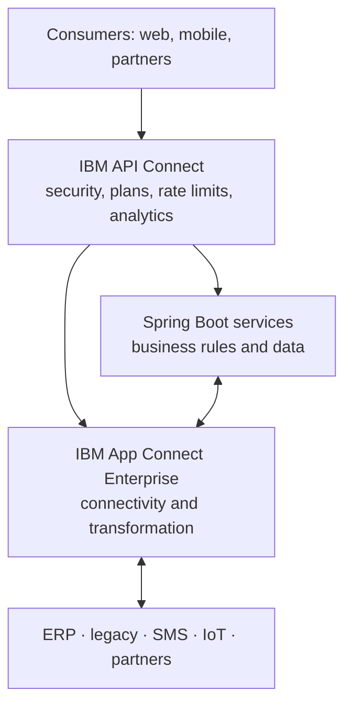

# ACE or Spring Boot? Where integration logic should live

Teams that have both IBM App Connect Enterprise and Spring Boot often ask the same question: *should
this go in ACE or in a service?* Choosing badly leads to business rules hidden in integration flows,
or hand-written plumbing that ACE would have handled for free.

Here's how I decide.

<!-- more -->

## Three layers, three jobs

- **API Connect** is the front door: it publishes APIs, applies security policies, plans and rate
  limits, and gives you analytics.
- **Spring Boot services** own the **business domain**: rules, validation and their own data.
- **App Connect Enterprise** owns **connectivity**: protocols, formats, routing and mediation
  between systems.

## Put it in ACE when...

- You are **translating** between formats (JSON, XML, CSV, fixed-width) or protocols (HTTP, MQ, files, SOAP).
- You are **routing** messages to different back ends based on content.
- You are integrating **packaged or legacy systems** you can't change.
- The logic is about **how** systems talk, not **what** the business decides.

## Put it in Spring Boot when...

- The logic is a **business rule** that the business will want to change and test.
- It needs its **own data** and transactions.
- It requires **rich unit tests** and fast developer iteration.
- It is a capability other systems will call, such as "place order" or "calculate entitlement".

## Warning signs

| Symptom | What it usually means |
|---|---|
| ESQL with hundreds of lines of `IF` business conditions | Domain logic has leaked into the integration layer. |
| A Spring service full of SOAP clients and format mapping | You are rebuilding an integration engine by hand. |
| Each consumer calling back ends directly | You are missing a gateway: security and visibility suffer. |
| The same transformation copied into many flows | Move it into a shared library. |

## A simple rule

> If the business would describe it, it belongs in a **service**.
> If only an integration engineer would describe it, it belongs in **ACE**.
> If it's about who may call what, and how often, it belongs in **API Connect**.

Keeping those boundaries clean is what lets an enterprise landscape keep growing without turning
into a tangle.

Questions or feedback on this post? [Contact me](../../../portfolio/contact.md).
