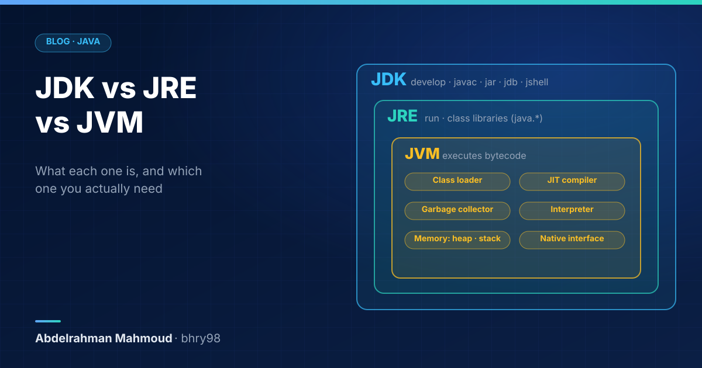
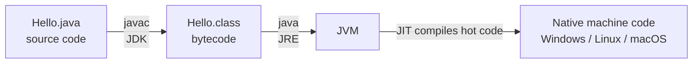

# JDK vs JRE vs JVM: What They Are and How They Differ



Three acronyms, one letter apart, and they confuse almost every Java beginner (and some seniors).
The short version: **the JVM runs Java bytecode, the JRE is what you need to run Java programs, and
the JDK is what you need to build them.** Here's the long version, with what it means for your
laptop, your servers and your container images.

<!-- more -->

## From source code to running program



1. You write `Hello.java`.
2. The **compiler** `javac` (part of the **JDK**) turns it into **bytecode** (`Hello.class`), an
   instruction set for a virtual CPU, not for Intel or ARM.
3. The **JVM** loads and runs that bytecode, and its **JIT compiler** turns frequently used code
   into real machine code at runtime.

Because every platform has its own JVM, the same `.class` or `.jar` runs everywhere: **"write once,
run anywhere"**.

## JVM: Java Virtual Machine

The **engine** that executes bytecode. It is a specification, with implementations such as
**HotSpot** (the default in OpenJDK) and **Eclipse OpenJ9**.

What's inside:

| Part | Job |
|---|---|
| **Class loader** | Finds and loads `.class` files from JARs and the classpath/module path |
| **Bytecode verifier** | Checks the bytecode is safe before running it |
| **Interpreter + JIT compiler** | Runs bytecode; compiles hot methods to native code (C1/C2 in HotSpot) |
| **Garbage collector** | Frees memory automatically (G1, ZGC, Shenandoah, Parallel…) |
| **Runtime memory areas** | Heap (objects), stacks (per thread), metaspace (class metadata) |

The JVM is also why tuning flags look like `-Xmx2g`, `-XX:+UseZGC` or
`-XX:MaxRAMPercentage=75`: they configure the virtual machine, not your program.

!!! note "The JVM is not just for Java"
    Kotlin, Scala, Groovy and Clojure also compile to bytecode and run on the same JVM.

## JRE: Java Runtime Environment

**JRE = JVM + the standard class libraries** (`java.lang`, `java.util`, `java.net`, `java.sql`…)
and supporting files. It is everything needed to **run** a Java application, and nothing to build
one: no `javac`, no debugger.

!!! info "Is the JRE dead?"
    Since **Java 11**, Oracle and OpenJDK no longer ship a separate JRE download. The JDK is the
    standard distribution, and you can build a **custom, minimal runtime** for your app with
    `jlink`. Vendors such as **Eclipse Temurin** still publish JRE builds (for example the
    `eclipse-temurin:21-jre` container image) because they are handy for small images.

## JDK: Java Development Kit

**JDK = JRE + development tools.** Install it on any machine where you write, compile or build Java.

| Tool | What it does |
|---|---|
| `javac` | Compiles `.java` to `.class` |
| `java` | Launches the JVM |
| `jar` | Packages classes into a JAR |
| `javadoc` | Generates API documentation |
| `jshell` | Interactive Java REPL |
| `jdb` | Command-line debugger |
| `jlink`, `jpackage` | Build a custom runtime / native installer |
| `jcmd`, `jstack`, `jmap`, `jfr` | Diagnose running JVMs: thread dumps, heap dumps, flight recordings |

## Side-by-side

| | **JVM** | **JRE** | **JDK** |
|---|---|---|---|
| What it is | Execution engine | Runtime environment | Development kit |
| Contains | Class loader, JIT, GC, memory | JVM + class libraries | JRE + compiler & tools |
| Can run Java apps | Not alone (needs the libraries) | Yes | Yes |
| Can compile Java | No | No | Yes (`javac`) |
| Who needs it | Comes inside the JRE/JDK | Servers / containers that only run apps | Developers, CI build agents |

Nested: **JDK ⊃ JRE ⊃ JVM**.

## OpenJDK, Oracle JDK, Temurin… which one?

**OpenJDK** is the open-source project where Java is developed. Many vendors build and support it;
they are functionally almost identical and all pass the same compatibility tests (TCK).

| Distribution | Vendor | Notes |
|---|---|---|
| **Eclipse Temurin** | Adoptium (Eclipse) | Free, popular default, official Docker images |
| **Red Hat build of OpenJDK** | Red Hat | Included with RHEL/OpenShift subscriptions; UBI images |
| **Amazon Corretto** | AWS | Free, long support, tuned for AWS |
| **Microsoft Build of OpenJDK** | Microsoft | Used across Azure |
| **Oracle JDK** | Oracle | Check the licence terms for production use |
| **Azul Zulu** | Azul | Free builds + commercial support |
| **GraalVM** | Oracle | Adds native-image compilation (fast startup) |

My default: **Temurin** on laptops and generic servers, **Red Hat build of OpenJDK** on RHEL and
OpenShift, and always an **LTS** version (17, 21, 25). Why LTS matters is in
[What does LTS mean?](../fundamentals/what-does-lts-mean.md).

## What to install where

- **Developer laptop:** a JDK (via SDKMAN!, `winget install EclipseAdoptium.Temurin.21.JDK`, or
  `sudo dnf install java-21-openjdk-devel`). Check with `java -version` and `javac -version`.
- **CI build agent:** a JDK, same major version as production.
- **Production server / container:** a JRE-sized runtime is enough. Use a multi-stage build: JDK
  to compile, JRE to run.

```dockerfile
# Build with the JDK…
FROM eclipse-temurin:21-jdk AS build
WORKDIR /src
COPY . .
RUN ./mvnw -q package -DskipTests

# …run with the JRE: a smaller image with fewer tools for an attacker to use
FROM eclipse-temurin:21-jre
COPY --from=build /src/target/*.jar /app/app.jar
ENTRYPOINT ["java", "-XX:MaxRAMPercentage=75", "-jar", "/app/app.jar"]
```

More on why containers change how we ship Java in
[Containers vs traditional deployment](../devops/containers-vs-traditional-deployment.md).

## Quick check: what do I have installed?

```bash
java -version      # runtime (JRE or JDK)
javac -version     # only works if a JDK is installed
echo $JAVA_HOME    # which installation tools like Maven use
```

```text
openjdk version "21.0.9" 2025-10-21 LTS
OpenJDK Runtime Environment Temurin-21.0.9+10 (build 21.0.9+10-LTS)
OpenJDK 64-Bit Server VM Temurin-21.0.9+10 (build 21.0.9+10-LTS, mixed mode, sharing)
```

The third line is your **JVM** (HotSpot "Server VM"), the second is the **runtime**, and `LTS`
tells you it's a long-term-support release.

## Takeaway

- **JVM** runs bytecode.
- **JRE** = JVM + libraries, enough to **run** Java.
- **JDK** = JRE + tools, needed to **build** Java.

Install a JDK where you write code, ship a JRE-sized runtime where you run it, and pick an LTS
version from a vendor you trust.

Build something with it: [How to create a simple CRUD API in Spring Boot](../../../how-to/spring-boot/simple-crud.md).
