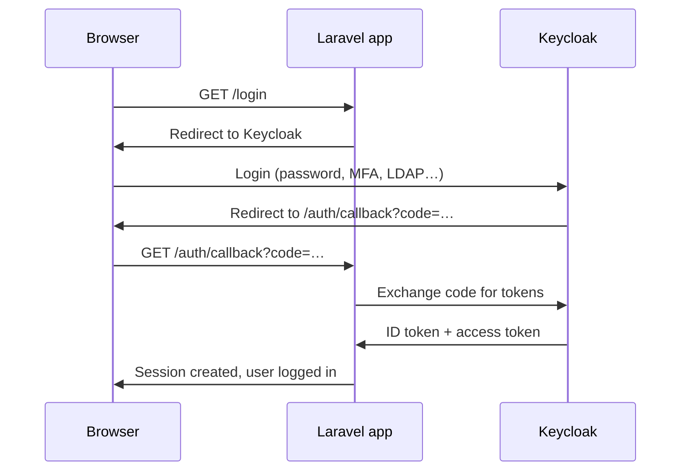

# Single sign-on for Laravel with Keycloak

When an organization runs more than two or three internal applications, separate logins become a
security and support problem: weak reused passwords, accounts that stay active after people leave,
and no central place to enforce MFA.

**Keycloak** solves this with standards-based single sign-on. Here's how I connect Laravel
applications to it.

<!-- more -->

## How the flow works

Laravel never sees the user's password. It redirects to Keycloak, and Keycloak sends the user back
with an authorization code that Laravel exchanges for tokens — the OpenID Connect
*authorization code flow*:



## 1. Configure Keycloak

In your realm:

1. **Create a client** — client type *OpenID Connect*, e.g. `crm-app`.
2. Turn on **Client authentication** (a confidential client, since Laravel runs on the server).
3. Set **Valid redirect URIs** to the exact callback, e.g. `https://crm.example.com/auth/callback`.
4. Set **Valid post logout redirect URIs** to your app's URL.
5. Copy the **client secret** from the *Credentials* tab.

If your users live in Active Directory, add an **LDAP user federation** to the realm — every
connected application gets AD login for free.

## 2. Connect Laravel with Socialite

Laravel Socialite plus the community Keycloak provider handle the protocol details:

```bash
composer require laravel/socialite socialiteproviders/keycloak
```

```php
// config/services.php
'keycloak' => [
    'client_id' => env('KEYCLOAK_CLIENT_ID'),
    'client_secret' => env('KEYCLOAK_CLIENT_SECRET'),
    'redirect' => env('KEYCLOAK_REDIRECT_URI'),
    'base_url' => env('KEYCLOAK_BASE_URL'),   // e.g. https://sso.example.com
    'realms' => env('KEYCLOAK_REALM'),        // e.g. company
],
```

Register the provider (Laravel 11+):

```php
// app/Providers/AppServiceProvider.php
use Illuminate\Support\Facades\Event;
use SocialiteProviders\Manager\SocialiteWasCalled;

public function boot(): void
{
    Event::listen(function (SocialiteWasCalled $event) {
        $event->extendSocialite('keycloak', \SocialiteProviders\Keycloak\Provider::class);
    });
}
```

Add the two routes:

```php
use App\Models\User;
use Illuminate\Support\Facades\Auth;
use Laravel\Socialite\Facades\Socialite;

Route::get('/login', fn () => Socialite::driver('keycloak')->redirect())
    ->name('login');

Route::get('/auth/callback', function () {
    $sso = Socialite::driver('keycloak')->user();

    $user = User::updateOrCreate(
        ['keycloak_id' => $sso->getId()],
        ['name' => $sso->getName(), 'email' => $sso->getEmail()],
    );

    Auth::login($user);
    session()->regenerate();

    return redirect()->intended('/dashboard');
});
```

!!! note
    Match users on the Keycloak **subject ID** (`getId()`), not on email. Emails change;
    the subject stays the same.

## 3. Log out properly

Clearing the Laravel session isn't enough — the Keycloak session is still alive, so the next
click on "Login" signs the user straight back in. Redirect to Keycloak's end-session endpoint
as well:

```php
Route::post('/logout', function () {
    Auth::logout();
    session()->invalidate();
    session()->regenerateToken();

    $query = http_build_query([
        'client_id' => config('services.keycloak.client_id'),
        'post_logout_redirect_uri' => url('/'),
    ]);

    return redirect(config('services.keycloak.base_url')
        .'/realms/'.config('services.keycloak.realms')
        .'/protocol/openid-connect/logout?'.$query);
});
```

## Mistakes I see most often

- **Wildcard redirect URIs** like `https://*` in production. Always list exact URLs.
- **Putting authorization only in Keycloak.** Use Keycloak roles or groups as *input*, but still
  enforce permissions in the app with policies and gates.
- **Not syncing roles.** Map realm or client roles from the token into your app on every login,
  so revoked access takes effect immediately.
- **Forgetting clock skew and TLS.** Keycloak and the app must agree on time, and the app must
  trust Keycloak's certificate.

## Going further

For APIs and mobile apps, validate Keycloak **access tokens** (JWTs) on each request instead of
using sessions. I'm packaging the patterns I use into
[keycloak-laravel-auth](https://github.com/bhry98/keycloak-laravel-auth).

Need SSO across your organization's apps? [Let's talk](../../portfolio/contact.md).
