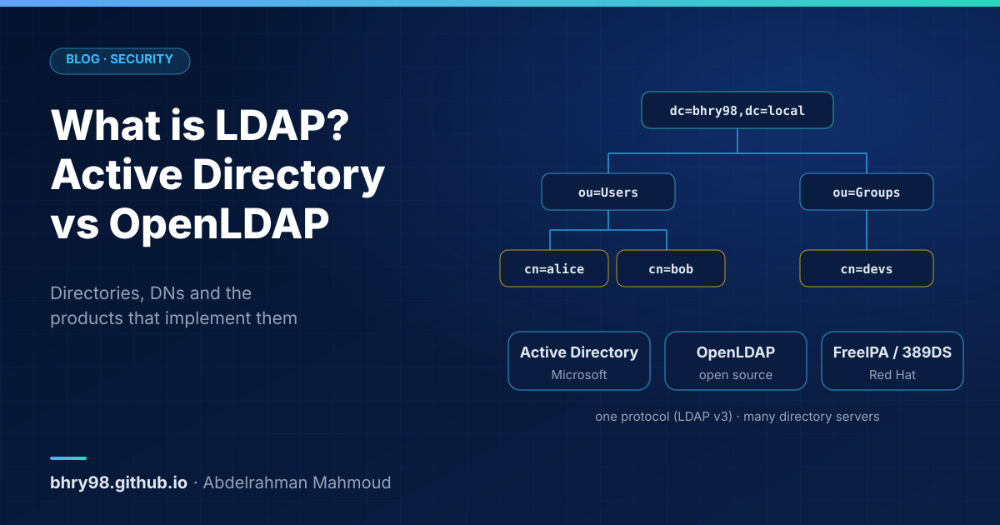
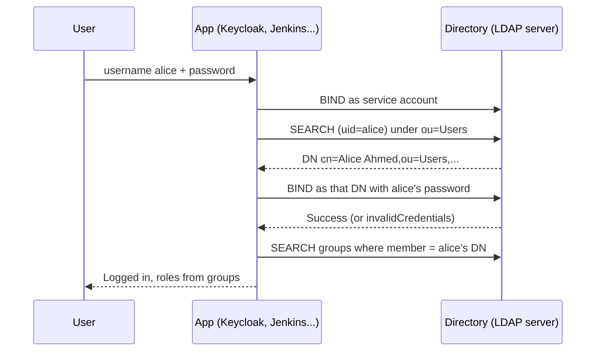

# Understanding LDAP: Active Directory vs OpenLDAP and Other Directory Servers



Every time you log in to a company laptop, VPN, Jenkins, GitLab or Keycloak with the same username
and password, there is very likely an **LDAP directory** behind it. This post explains what LDAP
is, how a directory is organised, and how the main products compare: **Active Directory,
OpenLDAP, FreeIPA / 389 Directory Server** and friends.

<!-- more -->

## What is LDAP?

**LDAP (Lightweight Directory Access Protocol)** is an open, standard **protocol** (version 3, RFC
4511) for reading and writing a **directory**: a database optimised for many fast reads and few
writes, that stores information about **users, groups, computers and other resources**.

Two things to keep apart:

- **LDAP** is the *protocol*: the language clients use (`bind`, `search`, `add`, `modify`).
- A **directory server** is the *product* that stores the data and speaks LDAP: Active Directory,
  OpenLDAP, 389 DS…

What companies use it for:

- **Central authentication:** one account for every app ("check this user's password").
- **Authorization:** group membership (`is alice in cn=devs?`).
- **Address book / lookup:** email, phone, manager, department.
- **Machine and service info:** computers, printers, service accounts.

## How a directory is organised

Data lives in a **tree** (the *DIT*, Directory Information Tree). Each node is an **entry** with
**attributes**, and is identified by its **Distinguished Name (DN)**, read from the leaf up to the root:

```text
dc=bhry98,dc=local                       ← root (the domain bhry98.local)
├── ou=Users
│   ├── cn=Alice Ahmed                    DN: cn=Alice Ahmed,ou=Users,dc=bhry98,dc=local
│   └── cn=Bob Hassan
└── ou=Groups
    └── cn=devs                           member: cn=Alice Ahmed,ou=Users,dc=bhry98,dc=local
```

| Abbreviation | Meaning | Example |
|---|---|---|
| `dc` | Domain component | `dc=bhry98,dc=local` |
| `ou` | Organizational unit (a "folder") | `ou=Users` |
| `cn` | Common name | `cn=Alice Ahmed` |
| `uid` / `sAMAccountName` | Login name (OpenLDAP / AD) | `alice` |
| `objectClass` | What kind of entry it is (defines allowed attributes) | `inetOrgPerson`, `user`, `group` |

An entry in **LDIF**, the text format for LDAP data:

```ldif
dn: cn=Alice Ahmed,ou=Users,dc=bhry98,dc=local
objectClass: inetOrgPerson
cn: Alice Ahmed
sn: Ahmed
uid: alice
mail: alice@bhry98.local
```

## How an application uses LDAP



Try it from any Linux machine with `ldapsearch`:

```bash
ldapsearch -x -H ldap://dc01.bhry98.local \
  -D "svc-ldap@bhry98.local" -W \
  -b "dc=bhry98,dc=local" "(sAMAccountName=alice)" cn mail memberOf
```

## LDAP vs LDAPS: always encrypt

| | Port | Traffic |
|---|---|---|
| **LDAP** | 389 | **Plain text**: passwords in simple binds can be sniffed |
| **LDAP + StartTLS** | 389 | Starts plain, then upgrades to TLS |
| **LDAPS** | 636 | TLS from the first byte (like HTTPS) |
| **Global Catalog** (AD only) | 3268 / **3269** (SSL) | Forest-wide search |

Never send passwords over plain 389 in production. Setting up LDAPS on Active Directory is a
step-by-step job, covered in
**[How to secure Active Directory with LDAPS](../../../how-to/active-directory/enable-ldaps-active-directory.md)**.

## The directory products compared

### Microsoft Active Directory (AD DS)

Far more than an LDAP server. AD combines **LDAP + Kerberos + DNS + Group Policy + replication**
to manage Windows domains: users log in to Windows PCs, computers get policies, admins use
familiar GUI tools.

- Attributes: `sAMAccountName`, `userPrincipalName` (`alice@bhry98.local`), `memberOf`.
- Multi-master replication between domain controllers, sites, forests and trusts.
- Runs on **Windows Server** only. The default in most enterprises.

### OpenLDAP

The classic open-source LDAP server (`slapd`) for Linux.

- Lightweight, fast and extremely flexible, with custom schemas and overlays (memberOf, password policy).
- Configured with LDIF (`cn=config`). Powerful, but there's no built-in GUI and a steep learning curve.
- Great for Linux-only environments, appliances, and as a backend for other products.

### 389 Directory Server / FreeIPA / Red Hat IdM

**389 DS** is Red Hat's open-source LDAP server. **FreeIPA** (sold as **Red Hat Identity
Management**) builds on it with Kerberos, DNS, a certificate authority, sudo rules, host-based
access control and a web UI. Think of it as "Active Directory for Linux". It can also **trust** an AD
forest, so Windows users can log in to Linux servers.

### Others you'll meet

- **Microsoft Entra ID (Azure AD)**: cloud identity for Microsoft 365. Despite the old name it
  is **not** an LDAP server (it uses OAuth2/OIDC/SAML); *Entra Domain Services* adds managed LDAP.
- **Samba AD DC**: an open-source, AD-compatible domain controller on Linux.
- **Apache Directory Server / ApacheDS**, **OpenDJ / PingDS**: Java-based LDAP servers.
- **JumpCloud, Google Cloud Identity (Secure LDAP)**: directory-as-a-service with LDAP endpoints.
- **Keycloak** is *not* a directory. It **uses** one: through *User Federation* it reads users from
  AD/LDAP and offers modern SSO (OIDC/SAML) to your apps. See [How to install Keycloak](../../../how-to/keycloak/install-keycloak.md).

### Comparison table

| | **Active Directory** | **OpenLDAP** | **FreeIPA / Red Hat IdM** | **Entra ID** |
|---|---|---|---|---|
| Type | Full Windows domain service | Pure LDAP server | Linux identity suite | Cloud identity (IdP) |
| Licence | Windows Server licence | Open source | Open source / RH subscription | Microsoft subscription |
| Platform | Windows Server | Linux/Unix | RHEL, Fedora, CentOS Stream | SaaS |
| LDAP v3 | Yes | Yes | Yes (389 DS) | No (only via Domain Services) |
| Kerberos | Built in | Separate (MIT/Heimdal) | Built in | No (cloud Kerberos for hybrid only) |
| Policies for machines | Group Policy (Windows) | No | HBAC, sudo rules (Linux) | Intune / Conditional Access |
| Built-in CA | AD CS (separate role) | No | Dogtag CA, built in | No |
| Admin UI | ADUC, ADAC, PowerShell | CLI / 3rd-party (phpLDAPadmin) | Web UI + CLI | Web portal |
| Best for | Windows-centric companies | Custom, lightweight Linux directories | Linux fleets, AD trusts | Microsoft 365, cloud SSO |

## Which one should you choose?

- **Mostly Windows PCs and Microsoft software?** Active Directory. Nothing else manages Windows as well.
- **Linux servers needing central logins, sudo rules and certificates?** FreeIPA / Red Hat IdM,
  optionally trusted with AD.
- **An app or appliance that just needs a small LDAP backend?** OpenLDAP or 389 DS.
- **Cloud-first with Microsoft 365?** Entra ID, synced from on-prem AD if you have one.
- **Modern web apps and APIs?** Put **Keycloak** in front of your directory and let apps use OIDC
  instead of talking LDAP directly.

## Takeaway

LDAP is the common language; Active Directory, OpenLDAP and FreeIPA are different servers that
speak it, each with its own extras. Whatever you run, keep the directory as the **single source of
truth** for identities, and **always use LDAPS**.

Next: [Secure your Windows Active Directory with LDAPS (Windows Server 2025)](../../../how-to/active-directory/enable-ldaps-active-directory.md)
