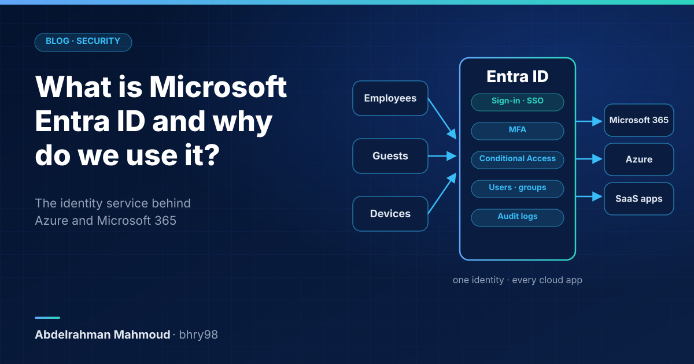
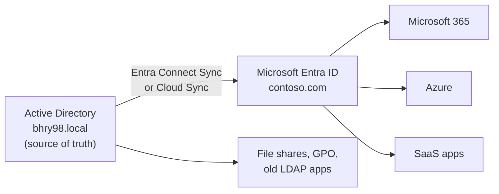

# What Is Microsoft Entra ID (Azure AD) and Why Do We Use It?

If your company uses Outlook, Teams or anything in Azure, you already have Microsoft Entra ID,
even if nobody calls it that. Most people still say "Azure AD". In this post I explain what
Entra ID actually is, how it is different from the Active Directory running on your domain
controllers, and why so many companies end up putting it at the center of their logins.

<!-- more -->

## First, the name

Microsoft renamed **Azure Active Directory** to **Microsoft Entra ID** in 2023. Same product, same
tenant, same features. "Entra" is now the family name for Microsoft's identity products:

| Product | What it does |
|---|---|
| **Entra ID** | The main one: users, groups, sign-in, SSO, MFA, Conditional Access |
| Entra ID Governance | Access reviews, joiner/mover/leaver workflows, entitlement management |
| Entra External ID | Sign-in for customers and partners (the replacement for Azure AD B2C) |
| Entra Connect / Cloud Sync | Tools that copy users from on-premises AD into Entra ID |

So when you read an old blog post about "Azure AD Connect" or an "Azure AD tenant", just replace
the name with Entra in your head. Nothing else changed.

## So what is it?

Entra ID is Microsoft's **cloud identity service**. It keeps a list of your users, groups,
devices and applications, and it answers one question all day long:

> Is this person who they say they are, and are they allowed into this app right now?

Every time someone signs in to Microsoft 365, the Azure portal, or any app that shows the
Microsoft login page, that request goes to Entra ID. It checks the password (or passkey, or
Windows Hello), asks for MFA if needed, looks at the device and location, and then hands the app
a token that says "this is alice@contoso.com, she is in these groups".

Each company gets its own isolated copy called a **tenant**, with a default domain like
`contoso.onmicrosoft.com`. You then add your real domain (`contoso.com`) so users sign in with
their normal email address.

## Entra ID is not "Active Directory in the cloud"

This is the part that confuses most people, me included the first time. The old name made it
sound like a domain controller hosted by Microsoft. It is not.

| | Active Directory (AD DS) | Microsoft Entra ID |
|---|---|---|
| Where it runs | Your servers (domain controllers) | Microsoft's cloud, nothing to install |
| Built for | Windows networks inside an office | Web apps, SaaS and mobile over the internet |
| Protocols | Kerberos, NTLM, LDAP | OpenID Connect, OAuth 2.0, SAML, SCIM |
| Structure | Forests, domains, OUs, Group Policy | Flat: one tenant, users, groups, admin units |
| Computers | Domain join, GPOs | Entra join, managed with Intune |
| Can apps use LDAP against it? | Yes | No |
| Who patches and backs it up | You | Microsoft |

The short version: **AD is for the network, Entra ID is for the internet.** An old in-house app
that does an LDAP bind will not work against Entra ID. A modern SaaS app that wants SAML or OIDC
will not talk to your domain controller directly. That is why most companies run both and connect
them (more on that below).

!!! note "What about Entra Domain Services?"
    If you really need LDAP or Kerberos in Azure for a lifted-and-shifted app, there is a paid
    add-on called Microsoft Entra Domain Services that gives you managed domain controllers. It is
    a separate service, not a feature of Entra ID itself.

If LDAP, binds and DNs are new to you, my post
**[Understanding LDAP: Active Directory vs OpenLDAP](what-is-ldap-active-directory-vs-openldap.md)**
covers that side.

## Why companies use it

### 1. One account for everything (SSO)

Users sign in once and get into Microsoft 365, Azure, Salesforce, ServiceNow, GitHub, Jira,
Zoom and thousands of other apps from the gallery, plus your own apps through OIDC or SAML. When
someone leaves, you disable one account and their access to all of it stops. That alone is the
main reason security teams push for it.

### 2. MFA and passwordless

Turning on MFA for every user is a few clicks. You can use the Microsoft Authenticator app,
FIDO2 security keys, passkeys or Windows Hello for Business, and slowly move people away from
passwords altogether.

### 3. Conditional Access

This is the feature I find most useful in practice. You write rules like:

- Admins must always use MFA from a compliant device.
- Block sign-ins from countries where we have no staff.
- Finance apps only from company laptops.
- If the sign-in looks risky, force a password change.

Entra ID checks these rules on every sign-in, not just once at login time on the office network.
This is the "zero trust" idea in a form you can actually configure.

### 4. Access for people outside the company

Partners and contractors can be invited as **guests** (B2B) and sign in with their own company
account. No need to create and later forget to delete local accounts for them.

### 5. It is already there

If you pay for Microsoft 365, you already have a tenant and the Free tier of Entra ID. For a lot
of companies the question is not "should we buy it" but "should we start using what we already
pay for".

## Licences in one table

| Edition | You get | Typical use |
|---|---|---|
| **Free** | Users, groups, SSO to apps, basic MFA (security defaults), sync from AD | Small companies, anything with Microsoft 365 |
| **P1** | Conditional Access, dynamic groups, self-service password reset with writeback to AD, Application Proxy | Most companies end up here |
| **P2** | Everything in P1 plus Identity Protection (risk-based sign-in) and PIM (just-in-time admin roles) | Stricter security needs |

P1 is included in Microsoft 365 E3 and Business Premium, P2 in E5, so check what your licences
already cover before buying anything. Prices and bundles change often, so always confirm on
Microsoft's licensing page.

## Hybrid: AD and Entra ID together

Very few companies start fresh in the cloud. The usual setup is:

HR creates the user in Active Directory like always. A sync tool copies that user (and a hash of
the password hash) to Entra ID, so the same username and password work for both the office
network and Microsoft 365. You keep managing people in one place and you don't end up with two
passwords per person.

I wrote a full step-by-step guide for this:
**[How to sync Active Directory users to Microsoft Entra ID](../../../how-to/entra-id/sync-active-directory-to-entra-id.md)**.

## Where Keycloak fits

On this blog I write a lot about Keycloak, so a fair question is: Keycloak or Entra ID?

- **Entra ID** makes sense when the company already lives in Microsoft 365 and wants a managed
  service with MFA, Conditional Access and device compliance built in.
- **Keycloak** makes sense when you need full control, run on-premises or in OpenShift, cannot
  send identity data to a public cloud, or want to avoid per-user licence costs.

They also work together. Keycloak can use Entra ID as an external identity provider over OIDC,
so employees sign in with their Microsoft account while your apps keep talking to Keycloak.

## Summary

- Microsoft Entra ID is the new name for Azure AD: Microsoft's cloud identity service.
- It handles sign-in, SSO, MFA and Conditional Access for Microsoft 365, Azure and any app that
  speaks OIDC, SAML or OAuth 2.0.
- It is not a domain controller. No LDAP, no Group Policy, no OUs.
- Most companies run AD and Entra ID side by side and sync users from AD to the cloud.
- If you have Microsoft 365, you already have it. Start with MFA and SSO, add Conditional Access
  when you get P1.
