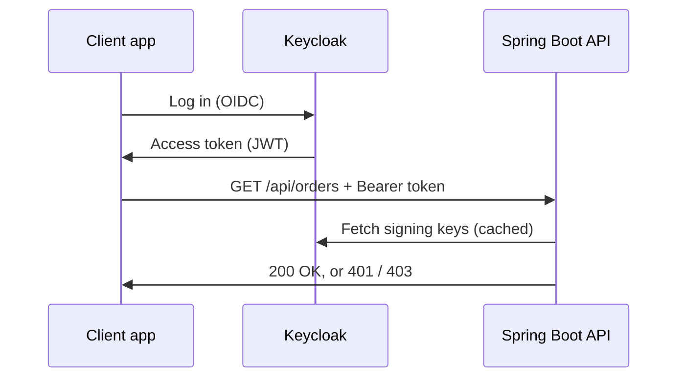

# Securing Spring Boot APIs with Keycloak

When an organization runs many services, each one managing its own users quickly becomes a
security problem. **Keycloak** centralizes authentication. Your Spring Boot APIs only need to
check the token that comes with each request.

<!-- more -->

## How it fits together

The client (an Angular app, a mobile app or another service) gets an **access token** from
Keycloak and sends it in the `Authorization: Bearer ...` header. The API validates the token's
signature with Keycloak's public keys. It never sees a password.



## 1. Configure Keycloak

In your realm:

1. Create a client for the front end, e.g. `orders-ui` (public client, standard flow with PKCE).
2. Create **realm roles** such as `orders.read` and `orders.write`, and assign them to users or groups.
3. If users live in a directory, add **LDAP user federation** to the realm.

## 2. Make the API a resource server

```xml
<dependency>
  <groupId>org.springframework.boot</groupId>
  <artifactId>spring-boot-starter-oauth2-resource-server</artifactId>
</dependency>
```

```yaml
spring:
  security:
    oauth2:
      resourceserver:
        jwt:
          issuer-uri: https://sso.example.com/realms/company
```

With `issuer-uri` set, Spring discovers the signing keys and checks the token's signature,
expiry and issuer automatically.

## 3. Map Keycloak roles to Spring authorities

Keycloak puts realm roles inside a `realm_access.roles` claim, which Spring does not read by
default. A small converter fixes that:

```java
@Configuration
@EnableMethodSecurity
class SecurityConfig {

    @Bean
    SecurityFilterChain api(HttpSecurity http) throws Exception {
        http
            .authorizeHttpRequests(auth -> auth
                .requestMatchers("/actuator/health/**").permitAll()
                .anyRequest().authenticated())
            .oauth2ResourceServer(oauth -> oauth
                .jwt(jwt -> jwt.jwtAuthenticationConverter(keycloakRoles())))
            .sessionManagement(s -> s.sessionCreationPolicy(SessionCreationPolicy.STATELESS));
        return http.build();
    }

    private JwtAuthenticationConverter keycloakRoles() {
        var converter = new JwtAuthenticationConverter();
        converter.setJwtGrantedAuthoritiesConverter(jwt -> {
            Map<String, Object> realmAccess = jwt.getClaimAsMap("realm_access");
            if (realmAccess == null) return List.of();
            @SuppressWarnings("unchecked")
            var roles = (Collection<String>) realmAccess.getOrDefault("roles", List.of());
            return roles.stream()
                .map(role -> (GrantedAuthority) new SimpleGrantedAuthority("ROLE_" + role))
                .toList();
        });
        return converter;
    }
}
```

Now authorization reads like the business rules:

```java
@GetMapping("/api/orders")
@PreAuthorize("hasRole('orders.read')")
List<Order> list() { ... }
```

## Mistakes I see most often

- **Wildcard redirect URIs** such as `*` on clients. Always list exact URLs.
- **Trusting the token without checking the audience** when many clients share a realm. Add an
  audience mapper in Keycloak and validate it in the API.
- **Long-lived access tokens.** Keep them short (minutes) and rely on refresh tokens.
- **Doing all authorization in Keycloak.** Use roles as input, but keep business rules such as
  "a user can only see their own orders" in the service.

## Service-to-service calls

For backend-to-backend calls, use the **client credentials** grant: the calling service gets its
own token with its own roles, so every call is authenticated and auditable.

Need SSO across your organization's applications? [Let's talk](../../portfolio/contact.md).
