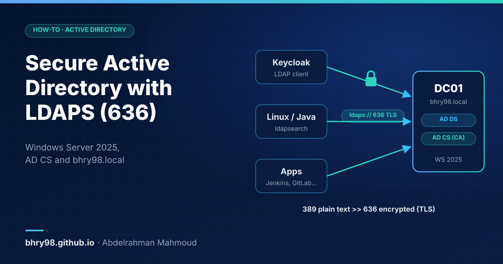
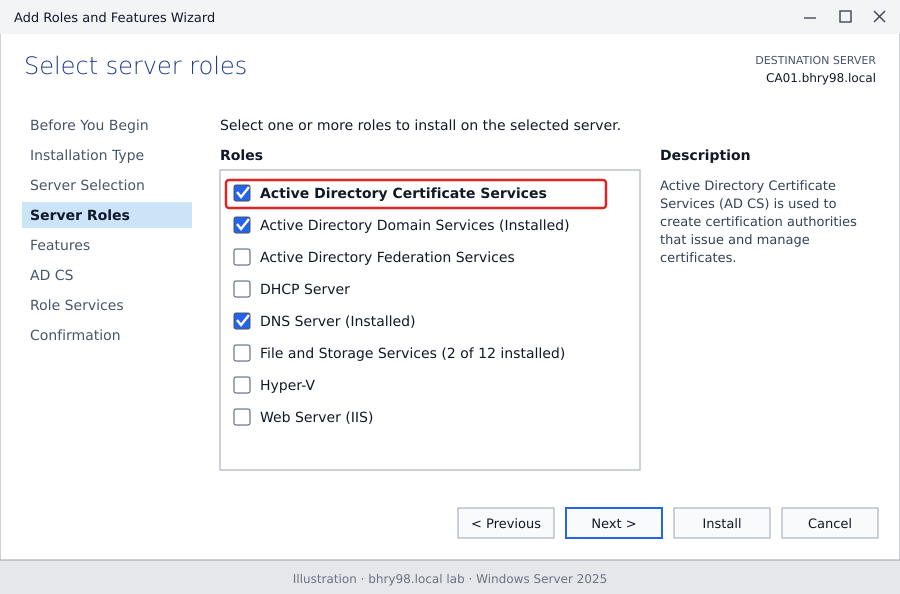
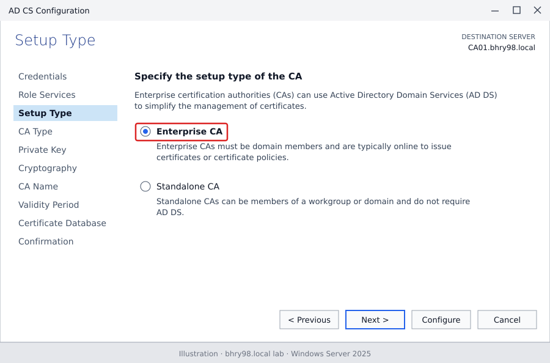
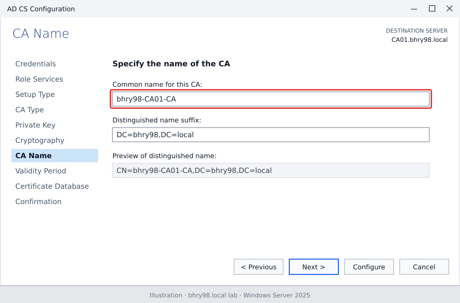
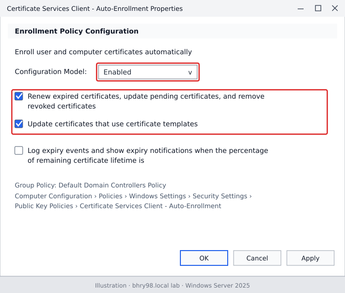
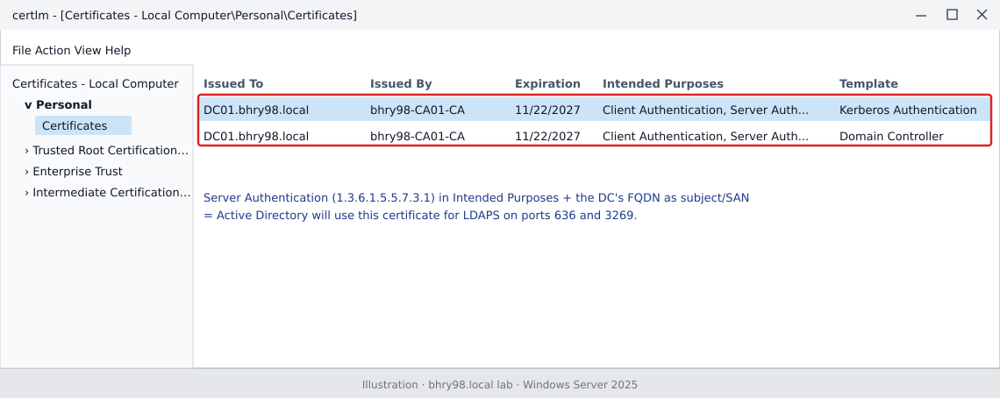
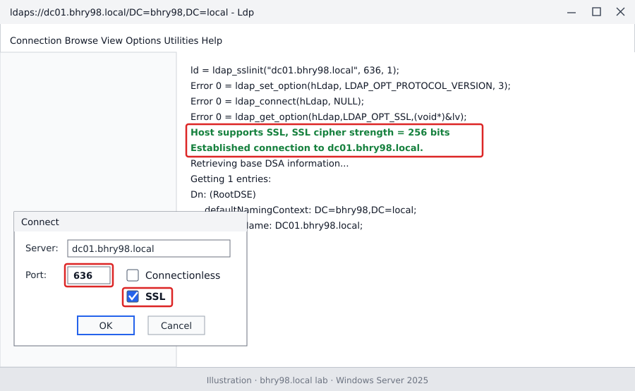

# How to secure Active Directory with LDAPS (Windows Server 2025)



!!! info "Before you start"
    Read **[Understanding LDAP: Active Directory vs OpenLDAP](../../blog/posts/security/what-is-ldap-active-directory-vs-openldap.md)**
    if terms like *bind*, *DN* or *LDAP vs LDAPS* are new to you.

By default, applications talk to Active Directory over **LDAP on port 389**, and a *simple bind*
sends the username and password in **plain text** across the network. **LDAPS** wraps the same
protocol in TLS on **port 636**, exactly like HTTPS does for HTTP.

Domain controllers turn on LDAPS **automatically** as soon as they have a suitable certificate.
So the job is really: *give every DC a trusted certificate and keep it renewed*. The cleanest way
is an **Enterprise CA** with Active Directory Certificate Services (AD CS) and auto-enrollment.

By the end of this guide you will have:

- [x] An Enterprise Root CA for `bhry98.local`
- [x] Every domain controller auto-enrolled with a server certificate that renews itself
- [x] LDAPS working on `ldaps://dc01.bhry98.local:636` (and the Global Catalog on 3269)
- [x] Linux, Java and Keycloak clients trusting your CA

## Lab used in this guide

| Host | IP | OS | Role |
|---|---|---|---|
| `DC01.bhry98.local` | `10.0.0.10` | Windows Server 2025 | Domain controller (AD DS + DNS) for `bhry98.local` |
| `CA01.bhry98.local` | `10.0.0.20` | Windows Server 2025 | Domain member, will become the Enterprise CA |
| `client` | any | Windows 11 / Linux | Testing |

!!! note "About the screenshots"
    The pictures in this guide are **illustrations** of the Windows Server 2025 dialogs, drawn with
    the exact values of this lab (`bhry98.local`, `CA01`, `DC01`), so you can compare them with your
    own screen field by field.

!!! tip "Small lab with only one server?"
    Microsoft recommends **not** installing AD CS on a domain controller. In a throw-away lab it
    works if you run every CA step on `DC01`, but use a separate server anywhere else.

## Prerequisites

| Requirement | Notes |
|---|---|
| A working AD domain `bhry98.local` | DC01 promoted, DNS working |
| A second server joined to the domain | `CA01`, for AD CS |
| An account in **Enterprise Admins** and **Domain Admins** | Needed to install an Enterprise CA |
| Time in sync | Kerberos and certificates both fail with clock skew |

Check from DC01 that the domain is healthy before you start:

```powershell
dcdiag /q            # no output = no errors
Resolve-DnsName ca01.bhry98.local
```

## Step 1: Install the AD CS role on CA01

Sign in to **CA01** as `BHRY98\Administrator` (an Enterprise Admin).

=== "Server Manager (GUI)"

    1. **Server Manager** → **Manage** → **Add Roles and Features**.
    2. **Installation Type:** *Role-based or feature-based installation*.
    3. **Server Selection:** `CA01.bhry98.local`.
    4. **Server Roles:** check **Active Directory Certificate Services**, accept **Add Features**.
    5. **Role Services:** keep only **Certification Authority**.
    6. **Install**, then close the wizard when it finishes.

    
    /// caption
    Server Roles: select **Active Directory Certificate Services**.
    ///

=== "PowerShell"

    ```powershell
    Install-WindowsFeature ADCS-Cert-Authority -IncludeManagementTools
    ```

<!-- REAL SCREENSHOT (optional): save your own as images/01-add-adcs-role.png and switch the link above -->

## Step 2: Configure an Enterprise Root CA

An **Enterprise** CA is integrated with AD: it publishes its certificate to every domain member,
uses certificate templates, and supports auto-enrollment. That is what makes LDAPS automatic.

=== "Server Manager (GUI)"

    1. Click the **flag** notification in Server Manager → **Configure Active Directory Certificate
       Services on the destination server**.
    2. **Credentials:** `BHRY98\Administrator` → **Next**.
    3. **Role Services:** check **Certification Authority**.
    4. **Setup Type:** **Enterprise CA**.

        
        /// caption
        Setup Type: **Enterprise CA**.
        ///

    5. **CA Type:** **Root CA**.
    6. **Private Key:** *Create a new private key*.
    7. **Cryptography:** `RSA#Microsoft Software Key Storage Provider`, key length **4096**,
       hash **SHA256**.
    8. **CA Name:** keep the default `bhry98-CA01-CA`. The suffix is `DC=bhry98,DC=local`.

        
        /// caption
        CA Name: the common name your clients will see as the issuer.
        ///

    9. **Validity Period:** **10 years** (a root CA should outlive the certificates it issues).
    10. **Certificate Database:** keep the defaults → **Configure**.

=== "PowerShell"

    ```powershell
    Install-AdcsCertificationAuthority `
      -CAType EnterpriseRootCA `
      -CACommonName "bhry98-CA01-CA" `
      -CryptoProviderName "RSA#Microsoft Software Key Storage Provider" `
      -KeyLength 4096 `
      -HashAlgorithmName SHA256 `
      -ValidityPeriod Years -ValidityPeriodUnits 10 `
      -Force
    ```

Check that the CA is running and which templates it publishes:

```powershell
Get-Service certsvc
certutil -CATemplates
```

```text
DomainController: Domain Controller -- Auto-Enroll
KerberosAuthentication: Kerberos Authentication -- Auto-Enroll
DomainControllerAuthentication: Domain Controller Authentication -- Auto-Enroll
WebServer: Web Server -- Access is denied
...
```

The **Kerberos Authentication** and **Domain Controller** templates are published by default and
allow the **Domain Controllers** group to auto-enroll. Both include the *Server Authentication*
purpose and the DC's DNS name, which is exactly what LDAPS needs.

!!! tip "Production PKI"
    For production, Microsoft's recommended design is an **offline standalone root CA** plus an
    **online enterprise subordinate CA**. The DC side of this guide (Steps 3–6) is identical; only
    the CA setup differs.

## Step 3: Turn on certificate auto-enrollment for domain controllers

Auto-enrollment makes DCs request **and renew** their certificates on their own. You only
configure it once.

=== "Group Policy (GUI)"

    1. On DC01, open **Group Policy Management** (`gpmc.msc`).
    2. **Forest** → **Domains** → `bhry98.local` → **Group Policy Objects** → right-click
       **Default Domain Controllers Policy** → **Edit**.
    3. Go to **Computer Configuration** → **Policies** → **Windows Settings** → **Security
       Settings** → **Public Key Policies**.
    4. Open **Certificate Services Client - Auto-Enrollment**:
        - **Configuration Model:** `Enabled`
        - Check **Renew expired certificates, update pending certificates, and remove revoked
          certificates**
        - Check **Update certificates that use certificate templates**
    5. **OK**.

    
    /// caption
    Auto-Enrollment in the **Default Domain Controllers Policy**.
    ///

=== "PowerShell"

    ```powershell
    # AEPolicy = 7: enabled + renew/remove + update templates (same as the GUI settings)
    Set-GPRegistryValue -Name "Default Domain Controllers Policy" `
      -Key "HKLM\SOFTWARE\Policies\Microsoft\Cryptography\AutoEnrollment" `
      -ValueName AEPolicy -Type DWord -Value 7
    ```

## Step 4: Enroll the domain controller certificate

On **DC01** (and later every other DC), apply the policy and trigger enrollment now instead of
waiting up to 8 hours:

```powershell
gpupdate /force
certutil -pulse
```

Check the computer's personal certificate store:

```powershell
Get-ChildItem Cert:\LocalMachine\My |
  Where-Object { $_.EnhancedKeyUsageList.FriendlyName -contains "Server Authentication" } |
  Format-List Subject, DnsNameList, Issuer, NotAfter, Thumbprint
```

```text
Subject     :
DnsNameList : {DC01.bhry98.local, bhry98.local, BHRY98}
Issuer      : CN=bhry98-CA01-CA, DC=bhry98, DC=local
NotAfter    : 11/22/2027 10:15:42 AM
Thumbprint  : 4F2A...
```

Or graphically with `certlm.msc` → **Personal** → **Certificates**:


/// caption
DC01 now holds certificates from `bhry98-CA01-CA` with **Server Authentication** in *Intended Purposes*.
///

!!! note "What makes a certificate usable for LDAPS"
    - The DC's **FQDN** (`DC01.bhry98.local`) in the Subject or Subject Alternative Name
    - **Server Authentication** (OID `1.3.6.1.5.5.7.3.1`) in Enhanced Key Usage
    - A **private key** in the Local Computer store
    - Issued by a CA the **DC and the clients trust**

## Step 5: Make AD load the certificate

The DC picks up a valid certificate automatically, normally within minutes or after a reboot. To
load it **right now without a reboot**, ask AD to refresh its server certificate:

```powershell
@"
dn:
changetype: modify
add: renewServerCertificate
renewServerCertificate: 1
-
"@ | Set-Content -Encoding ascii $env:TEMP\ldaps-renew.ldf

ldifde -i -f $env:TEMP\ldaps-renew.ldf
```

```text
Connecting to "DC01.bhry98.local"
Logging in as current user using SSPI
Importing directory from file "C:\Users\ADMINI~1\AppData\Local\Temp\ldaps-renew.ldf"
Loading entries..
1 entry modified successfully.
```

## Step 6: Test LDAPS

### From the domain controller or a Windows client

Check the port is listening:

```powershell
Test-NetConnection dc01.bhry98.local -Port 636     # TcpTestSucceeded : True
Test-NetConnection dc01.bhry98.local -Port 3269    # Global Catalog over SSL
```

Then use **ldp.exe** (installed with the AD DS tools):

1. Run `ldp.exe`.
2. **Connection** → **Connect…**
3. **Server:** `dc01.bhry98.local` (the **FQDN**, not the IP, because it must match the certificate),
   **Port:** `636`, check **SSL** → **OK**.
4. Optional: **Connection** → **Bind** with a domain account to test a login.


/// caption
Success: *Host supports SSL, SSL cipher strength = 256 bits* and *Established connection*.
///

### From Linux

First export the CA certificate (Step 7), then:

```bash
# See the certificate chain the DC presents
openssl s_client -connect dc01.bhry98.local:636 -CAfile bhry98-CA.pem -showcerts </dev/null \
  | grep -E "subject=|issuer=|Verify return code"
```

```text
subject=
issuer=DC=local, DC=bhry98, CN=bhry98-CA01-CA
Verify return code: 0 (ok)
```

```bash
# Search the directory over LDAPS
LDAPTLS_CACERT=bhry98-CA.pem ldapsearch -H ldaps://dc01.bhry98.local:636 \
  -D "administrator@bhry98.local" -W \
  -b "dc=bhry98,dc=local" "(sAMAccountName=administrator)" cn memberOf
```

:material-check-circle:{ .bh-ok } **Done.** `bhry98.local` answers LDAPS on 636 with a trusted,
auto-renewing certificate.

## Step 7: Make clients trust your CA

**Domain-joined Windows machines** trust the Enterprise CA automatically (it is published in AD).
Everything else needs the CA certificate.

Export it on **CA01**:

```powershell
certutil -ca.cert C:\bhry98-CA.cer      # DER format
```

Copy `bhry98-CA.cer` to your clients, then:

=== "Linux (RHEL / Ubuntu)"

    ```bash
    openssl x509 -inform der -in bhry98-CA.cer -out bhry98-CA.pem

    # RHEL / Rocky / Fedora
    sudo cp bhry98-CA.pem /etc/pki/ca-trust/source/anchors/
    sudo update-ca-trust

    # Ubuntu / Debian
    sudo cp bhry98-CA.pem /usr/local/share/ca-certificates/bhry98-CA.crt
    sudo update-ca-certificates
    ```

=== "Java / Spring Boot"

    ```bash
    # Into a dedicated truststore
    keytool -importcert -noprompt -alias bhry98-ca -file bhry98-CA.cer \
      -keystore truststore.p12 -storetype PKCS12 -storepass changeit

    java -Djavax.net.ssl.trustStore=truststore.p12 \
         -Djavax.net.ssl.trustStorePassword=changeit -jar app.jar
    ```

=== "Keycloak"

    ```bash
    # Keycloak 25+: add the PEM to the system truststore used by Keycloak
    bin/kc.sh start --truststore-paths=/opt/keycloak/conf/truststores/bhry98-CA.pem ...
    ```

    Then in **User federation** → **Add LDAP provider**:

    | Field | Value |
    |---|---|
    | Vendor | Active Directory |
    | Connection URL | `ldaps://dc01.bhry98.local:636` |
    | Bind DN | `svc-keycloak@bhry98.local` |
    | Users DN | `OU=Users,DC=bhry98,DC=local` |

    Click **Test connection** and **Test authentication**. See
    [How to install Keycloak](../keycloak/install-keycloak.md) for the Keycloak setup itself.

## Step 8: Harden — stop plain-text LDAP

LDAPS only helps if clients actually use it. Once your apps are switched to `ldaps://`:

1. **Find who still uses insecure binds.** On each DC, raise LDAP interface logging and watch
   **Directory Service** event **2889** (each client doing an unsigned or clear-text bind) and **2887**
   (daily summary):

    ```powershell
    Set-ItemProperty "HKLM:\SYSTEM\CurrentControlSet\Services\NTDS\Diagnostics" `
      -Name "16 LDAP Interface Events" -Value 2
    ```

2. **Require LDAP signing** (Windows Server 2025 already requires it by default on new
   deployments; on older or upgraded domains set it yourself). In the **Default Domain Controllers
   Policy** → **Security Options**:
    - *Domain controller: LDAP server signing requirements* → **Require signing**
    - *Domain controller: LDAP server channel binding token requirements* → **When supported**, then
      **Always** once 2889 events are gone

3. **Firewall:** allow `636` and `3269` from the networks that need them; block `389`/`3268`
   from outside the server network if nothing legitimate uses them.

4. **Monitor certificate expiry.** Auto-enrollment renews it, but alert on Directory Service event
   **1220** (*LDAP over SSL will be unavailable…*) and on certificates close to expiry.

!!! warning "Test before enforcing"
    Requiring signing or channel binding breaks old devices (printers, scanners, appliances, old
    Java apps) that use plain simple binds on 389. Use the 2889 events to find and fix them first.

## Troubleshooting

??? question "`ldp` with SSL: *Cannot open connection* / error `0x51`"
    No usable certificate on the DC. Re-check Step 4 (Server Authentication EKU, FQDN, private key),
    run `certutil -pulse`, then Step 5. Look for event **1220** in the Directory Service log.

??? question "Works with the FQDN, fails with the IP address"
    Expected: the certificate is issued to `DC01.bhry98.local`, not to `10.0.0.10`. Always use the
    DNS name in connection URLs.

??? question "Linux / Java: `unable to get local issuer certificate` or `PKIX path building failed`"
    The client doesn't trust `bhry98-CA01-CA`. Import the CA certificate (Step 7) into the OS trust
    store or the Java truststore your app actually uses.

??? question "No certificate appears after `certutil -pulse`"
    Check the GPO reached the DC (`gpresult /r /scope computer`), that the CA is online
    (`certutil -ping`), and that the **Domain Controllers** group has *Enroll* and *Autoenroll* on
    the template (Certificate Templates console `certtmpl.msc` → template → **Security**).

??? question "Two DCs, only one works"
    Each DC needs its own certificate. Run Steps 4–6 on every domain controller.

## Next steps

- [Understanding LDAP: Active Directory vs OpenLDAP](../../blog/posts/security/what-is-ldap-active-directory-vs-openldap.md)
- [How to install Keycloak](../keycloak/install-keycloak.md) and federate users from `bhry98.local`
- [Microsoft: LDAP over SSL (LDAPS) certificate requirements](https://learn.microsoft.com/troubleshoot/windows-server/active-directory/enable-ldap-over-ssl-3rd-certification-authority)
