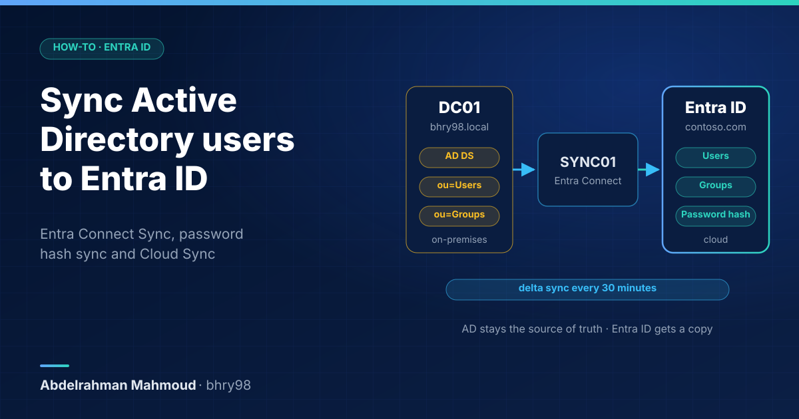
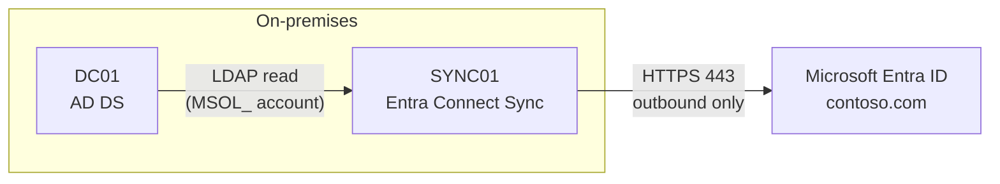

# How to sync Active Directory users to Microsoft Entra ID



!!! info "Before you start"
    New to Entra ID? Read **[What is Microsoft Entra ID and why do we use it?](../../blog/posts/security/what-is-microsoft-entra-id.md)** first.

Most companies already have their users in an on-premises Active Directory and now also need them
in Microsoft Entra ID for Microsoft 365, Azure and SaaS apps. Creating every user twice by hand
doesn't scale and ends with two passwords per person. The fix is to let AD stay the place where
you manage people and have a sync tool copy them to Entra ID.

In this guide I use **Microsoft Entra Connect Sync** (the tool people still call "Azure AD
Connect") with **password hash sync**, which is what I'd pick for most setups. At the end there
is a section on the lighter **Entra Cloud Sync** agent and when to use it instead.

By the end of this guide you will have:

- [x] Users from selected OUs in `bhry98.local` showing up in Entra ID
- [x] The same username and password working on-premises and in Microsoft 365
- [x] A sync running every 30 minutes on its own
- [x] A clear process for new users, changes and leavers

## Lab used in this guide

| Host | IP | OS | Role |
|---|---|---|---|
| `DC01.bhry98.local` | `10.0.0.10` | Windows Server 2025 | Domain controller (AD DS + DNS) |
| `SYNC01.bhry98.local` | `10.0.0.30` | Windows Server 2025 | Domain member, will run Entra Connect Sync |
| Entra tenant | | | `contoso.onmicrosoft.com` with the custom domain `contoso.com` verified |

Replace `contoso.com` with your own public domain everywhere below. It's the same domain lab as
my **[LDAPS guide](../active-directory/enable-ldaps-active-directory.md)**, so if you followed
that one you already have DC01.

## How it works



- Entra Connect reads users, groups and contacts from AD, applies your filters, and writes them to
  Entra ID. Only outbound HTTPS, no inbound ports to open.
- **AD is the source of authority.** A synced user is edited in AD, not in the Entra portal. Most
  fields are greyed out in the cloud.
- With password hash sync, Entra ID gets a hash of the AD password hash (never the password
  itself), so users sign in to the cloud without the request touching your DCs.
- Every 30 minutes it runs a *delta* sync that only sends what changed.

## Prerequisites

| Requirement | Notes |
|---|---|
| A working AD domain | `bhry98.local`, healthy (`dcdiag /q` shows nothing) |
| A Windows Server 2016 or newer, domain-joined | `SYNC01`. Not a domain controller (supported, but I'd avoid it) |
| An Entra tenant with your domain verified | **Entra admin center** → **Entra ID** → **Domain names** → **Add custom domain**, then add the TXT record it gives you |
| Entra account with the **Hybrid Identity Administrator** (or Global Administrator) role | Cloud-only account, `admin@contoso.onmicrosoft.com`, with MFA |
| AD account in **Enterprise Admins** | Only used during setup to create the sync service account |
| Outbound HTTPS 443 from SYNC01 | To the Microsoft endpoints; TLS 1.2 enabled |
| Fewer than about 100,000 objects | Otherwise use a full SQL Server instead of the built-in SQL Express LocalDB |

!!! warning "Clean up AD first"
    Whatever is in the OUs you pick will end up in the cloud. Duplicate `mail` or
    `proxyAddresses` values, users with empty `mail`, and old test accounts cause errors later.
    Microsoft's **IdFix** tool scans AD and lists these problems. Run it once before you start.

## Step 1: Give users a routable UPN

Users sign in to Entra ID with their UPN. `alice@bhry98.local` can't be used in the cloud because
nobody can verify `.local` on the internet. If you sync as-is, users get
`alice@contoso.onmicrosoft.com` instead, which nobody wants to type.

Add `contoso.com` as a UPN suffix on DC01, then move the users to it:

=== "PowerShell"

    ```powershell
    # 1. Add the suffix to the forest
    Get-ADForest | Set-ADForest -UPNSuffixes @{Add = "contoso.com"}

    # 2. See who still has the old suffix
    Get-ADUser -SearchBase "OU=Staff,DC=bhry98,DC=local" -Filter * |
        Where-Object UserPrincipalName -like "*@bhry98.local" |
        Select-Object SamAccountName, UserPrincipalName

    # 3. Change them (test on one OU first)
    Get-ADUser -SearchBase "OU=Staff,DC=bhry98,DC=local" -Filter * |
        Where-Object UserPrincipalName -like "*@bhry98.local" |
        ForEach-Object {
            $new = $_.UserPrincipalName -replace "@bhry98\.local$", "@contoso.com"
            Set-ADUser $_ -UserPrincipalName $new
        }
    ```

=== "GUI"

    1. **Active Directory Domains and Trusts** → right-click the root → **Properties**.
    2. **Alternative UPN suffixes:** add `contoso.com` → **OK**.
    3. In **Active Directory Users and Computers**, open a user → **Account** tab → pick
       `@contoso.com` in the drop-down next to the logon name.

Users can still log in to Windows as `BHRY98\alice` as before. Only the UPN changes.

!!! tip "Make UPN and email match"
    Life is easier when `alice@contoso.com` is both the UPN and the email address. Fill the `mail`
    attribute too, because Exchange Online and many apps read it.

## Step 2: Decide which OUs to sync

Don't sync the whole domain. Service accounts, disabled users and the built-in `Users` container
don't belong in the cloud. In this lab I sync two OUs:

```text
DC=bhry98,DC=local
├── OU=Staff          ← sync
├── OU=Groups         ← sync
├── OU=ServiceAccounts
└── CN=Users          (built-in, not synced)
```

You choose these OUs in the wizard in Step 4, and you can change them later.

## Step 3: Download and install on SYNC01

Sign in to **SYNC01** as a domain admin.

1. In the **Microsoft Entra admin center** (`entra.microsoft.com`), go to **Entra ID** →
   **Entra Connect** → **Connect Sync** and download the latest installer. Microsoft moved the
   download there; older links to the Download Center point at outdated versions.
2. Run `MicrosoftEntraConnectSyncSetup.msi` (the exact file name changes between releases).
3. Accept the licence terms → **Continue**.

## Step 4: Run the wizard with custom settings

**Express settings** syncs the entire forest with password hash sync. It works, but I prefer
**Customize** so I can choose the OUs.

1. **Install required components:** leave the defaults (built-in SQL Express LocalDB,
   auto-created service account) → **Install**.
2. **User sign-in:** select **Password Hash Synchronization** and tick **Enable single sign-on**
   (Seamless SSO, so domain-joined PCs on the network don't ask for a password again).
3. **Connect to Microsoft Entra ID:** sign in with `admin@contoso.onmicrosoft.com` and approve MFA.
4. **Connect your directories:** forest `bhry98.local` → **Add Directory** → **Create new AD
   account**, enter `BHRY98\Administrator` (Enterprise Admin). The wizard creates a low-privilege
   account named `MSOL_xxxxxxxx` that it uses from now on.
5. **Microsoft Entra sign-in configuration:** you should see `contoso.com` as **Verified** and
   `bhry98.local` as **Not Added**. Keep **USER PRINCIPAL NAME** as the attribute. Since all users
   are already on `@contoso.com` from Step 1, tick **Continue without matching all UPN suffixes
   to verified domains**.
6. **Domain and OU filtering:** choose **Sync selected domains and OUs** and tick only `Staff` and
   `Groups`.
7. **Uniquely identifying your users:** keep the defaults. Users are matched by UPN and the source
   anchor is `ms-DS-ConsistencyGuid`. Don't change this unless you know why.
8. **Filter users and devices:** **Synchronize all users and devices**.
9. **Optional features:** leave **Password hash synchronization** ticked. If you have Entra ID P1,
   also tick **Password writeback** so users can reset their AD password from the cloud.
10. **Enable single sign-on:** enter domain admin credentials when asked. This creates a computer
    account called `AZUREADSSOACC` in AD.
11. **Ready to configure:** tick **Start the synchronization process when configuration
    completes** → **Install**.

The first full sync starts right away. On a small domain it takes a few minutes.

!!! note "Staging mode"
    The same screen has **Enable staging mode**. A server in staging mode imports and calculates
    everything but doesn't write to Entra ID. Install a second server like that and you have a
    ready standby if SYNC01 dies.

## Step 5: Check that users arrived

=== "Entra admin center"

    **Entra ID** → **Users** → **All users**. Add the column **On-premises sync enabled**. Your AD
    users show **Yes**, cloud-only admins show **No**.

    **Entra ID** → **Entra Connect** → **Connect Sync** shows the last sync time and whether
    password hash sync is healthy.

=== "PowerShell (Microsoft Graph)"

    ```powershell
    Install-Module Microsoft.Graph -Scope CurrentUser
    Connect-MgGraph -Scopes "User.Read.All","Organization.Read.All"

    # When did the tenant last sync?
    Get-MgOrganization | Select-Object OnPremisesSyncEnabled, OnPremisesLastSyncDateTime

    # Is this user coming from AD?
    Get-MgUser -UserId alice@contoso.com `
        -Property DisplayName,UserPrincipalName,OnPremisesSyncEnabled,OnPremisesSamAccountName |
        Select-Object DisplayName, UserPrincipalName, OnPremisesSyncEnabled, OnPremisesSamAccountName
    ```

Then do the real test: open `https://myapps.microsoft.com` in a private browser window and sign
in as `alice@contoso.com` with her AD password.

## Step 6: Run and monitor sync from PowerShell

Everything below runs on **SYNC01** in an elevated PowerShell (the `ADSync` module is installed
with Entra Connect).

```powershell
# Status of the scheduler: is it on, when is the next run?
Get-ADSyncScheduler

# Push changes now instead of waiting up to 30 minutes
Start-ADSyncSyncCycle -PolicyType Delta

# After changing filters or rules: full sync
Start-ADSyncSyncCycle -PolicyType Initial

# Pause the scheduler during maintenance, then turn it back on
Set-ADSyncScheduler -SyncCycleEnabled $false
Set-ADSyncScheduler -SyncCycleEnabled $true
```

For errors on single objects, open **Synchronization Service Manager** (installed with Entra
Connect). The **Operations** tab lists every run; click a run with warnings to see which user
failed and why. The usual suspect is a duplicate `proxyAddresses` or UPN.

## Managing users day to day

Once sync is on, the rule is simple: **change users in AD, never in the cloud.** Here is what each
common task looks like.

| Task | Do this in AD | What happens in Entra ID |
|---|---|---|
| New employee | Create the user in `OU=Staff` with a `@contoso.com` UPN | Appears after the next sync. Assign the Microsoft 365 licence (or use group-based licensing) |
| Name, title, department, manager | Edit the user in AD | Updated on the next sync |
| Password change | User changes it with Ctrl+Alt+Del or you reset it in AD | Synced within about 2 minutes (password sync runs on its own schedule) |
| Add to a group | Add to a group inside `OU=Groups` | Group membership updated in Entra ID |
| Employee leaves | **Disable** the account in AD | Sign-in blocked after the next sync. Revoke sessions in Entra to cut access right away |
| Delete | Delete in AD (or move out of synced OUs) | User goes to **Deleted users** in Entra ID and is kept 30 days, then removed for good |

!!! danger "Moving a user out of a synced OU deletes them in the cloud"
    To Entra ID, a user that leaves the sync scope looks exactly like a deleted user. Their
    mailbox and OneDrive go with them after 30 days. Move users between synced OUs only, or
    restore them from **Deleted users** if it happens by mistake.

Entra Connect also has an **accidental delete** guard: if one sync run would delete more than 500
objects it stops and waits for you. Don't turn that off.

### What can still be done in the cloud

Some things are not part of sync and are managed in Entra ID even for synced users:

- Licence assignment, MFA methods and Conditional Access policies.
- Cloud-only groups (Microsoft 365 groups, Teams).
- Guest users and cloud-only admin accounts.

!!! tip "Keep admin accounts cloud-only"
    Use a separate cloud-only account (`admin@contoso.onmicrosoft.com`) for Global Administrator
    and similar roles, not a synced AD account. If AD is ever compromised, the attacker doesn't get
    your tenant too.

## Users that already exist in both places

If someone created `alice@contoso.com` by hand in Entra ID before you set up sync, Entra Connect
tries to link it to the AD user with the same UPN or primary SMTP address. This is called a
**soft match**. After the match, the cloud account becomes a synced account and AD wins from then
on.

Soft match is blocked for accounts that hold admin roles, on purpose. Remove the role, let it sync,
then add the role back (or better, keep admins cloud-only as above).

## Entra Cloud Sync instead of Connect Sync

Microsoft also offers **Microsoft Entra Cloud Sync**. Instead of a full sync server with its own
database, you install a small **provisioning agent** on one or more domain-joined servers, and
the sync configuration lives in the Entra admin center.

| | Entra Connect Sync | Entra Cloud Sync |
|---|---|---|
| What you install | Full sync engine with SQL LocalDB | Lightweight agent, install 2 or 3 for high availability |
| Where you configure it | Wizard on the server | Entra admin center |
| Sync interval | 30 minutes | About every 2 minutes |
| Several disconnected AD forests | Hard | Easy |
| Device sync (hybrid join), complex custom rules, very large directories | Yes | Limited |

My rule of thumb: for a new, simple setup (one forest, users and groups, password hash sync) try
Cloud Sync first because there is less to maintain. If you need hybrid-joined devices, custom
sync rules, or another feature Cloud Sync doesn't cover yet, use Connect Sync. The
two can run side by side on different OUs during a migration. Check Microsoft's current
comparison page before deciding, because Cloud Sync gains features often.

The Cloud Sync setup in short:

1. **Entra admin center** → **Entra ID** → **Entra Connect** → **Cloud sync** → **Agents** →
   download the agent.
2. Install it on SYNC01 (and later a second server) and sign in as Hybrid Identity Administrator.
3. Back in the portal: **New configuration** → **AD to Microsoft Entra ID sync** → pick
   `bhry98.local`.
4. **Scoping filters:** select the `Staff` and `Groups` OUs. Turn on **Password hash sync**.
5. **Enable** the configuration and use **Provision on demand** to test one user first.

## Troubleshooting

| Problem | Likely cause and fix |
|---|---|
| Users show up as `@contoso.onmicrosoft.com` | Their UPN suffix isn't a verified domain. Fix the UPN in AD (Step 1) and sync again |
| `AttributeValueMustBeUnique` error | Two objects have the same `proxyAddresses` or UPN. Find it with `Get-ADUser -Filter "proxyAddresses -eq 'smtp:alice@contoso.com'"` and fix the duplicate |
| User is in AD but not in Entra ID | Not in a synced OU, or filtered out. Check **Synchronization Service Manager** → **Metaverse search** |
| Password works on-premises but not in the cloud | Password hash sync off or failing. Check the Connect Sync health page and run `Start-ADSyncSyncCycle -PolicyType Delta` |
| "This operation can't be performed because the object is synced" in the portal | Expected. Edit that field in AD instead |
| Sync stopped with too many deletes | The accidental delete guard kicked in. Check what is being deleted before you allow it |

## Summary

- AD stays the place where you create, change and disable users. Entra ID gets a copy.
- Give users a routable UPN (`@contoso.com`) before the first sync.
- Sync only the OUs you need, with password hash sync for sign-in.
- `Start-ADSyncSyncCycle -PolicyType Delta` pushes changes right away; otherwise they go every
  30 minutes.
- Disable leavers in AD, keep admin accounts cloud-only, and be careful moving users between OUs.
