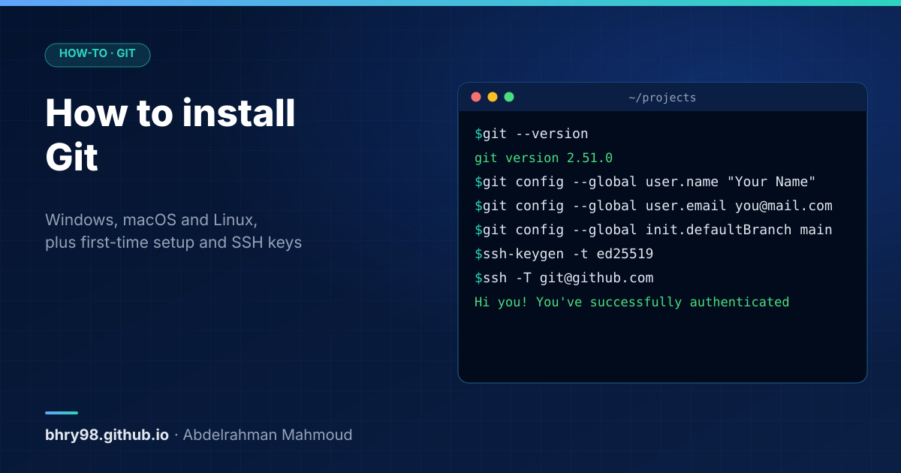

# How to install Git



!!! info "Before you start"
    Not sure what Git is, or how it differs from GitHub and GitLab? Read
    **[What is Git? GitHub vs GitLab vs Bitbucket compared](../../blog/posts/devops/what-is-git-github-gitlab-bitbucket.md)** first.

By the end of this guide you will have:

- [x] Git installed and on your `PATH`
- [x] Your name, email and default branch configured
- [x] An SSH key added to GitHub or GitLab
- [x] Your first repository cloned and a commit pushed

## Prerequisites

| Requirement | Notes |
|---|---|
| Windows 10/11, macOS 12+ or a Linux distribution | Admin / `sudo` rights to install |
| A GitHub or GitLab account | For Step 4 and later |

## Step 1: Install Git

=== "Windows"

    **Option A: winget (fastest)**

    ```powershell
    winget install --id Git.Git -e --source winget
    ```

    **Option B: installer**

    1. Download **Git for Windows** from <https://git-scm.com/downloads/win>.
    2. Run the installer. The defaults are fine; the choices worth checking are:
        - **Default editor:** pick one you know (VS Code, Notepad++), not Vim if you've never used it.
        - **Initial branch name:** *Override* → `main`.
        - **PATH:** *Git from the command line and also from 3rd-party software* (recommended).
        - **Line endings:** *Checkout Windows-style, commit Unix-style* (`core.autocrlf=true`).
    3. Close and reopen your terminal so the new `PATH` is loaded.

    You also get **Git Bash**, a Linux-like shell that is handy for the commands in this guide.

=== "macOS"

    ```bash
    # Option A: Apple's Command Line Tools (includes git)
    xcode-select --install

    # Option B: Homebrew, usually a newer version
    brew install git
    ```

=== "Ubuntu / Debian"

    ```bash
    sudo apt update
    sudo apt install -y git

    # Optional: latest stable Git on Ubuntu
    sudo add-apt-repository -y ppa:git-core/ppa
    sudo apt update && sudo apt install -y git
    ```

=== "RHEL / Rocky / Alma / Fedora"

    ```bash
    sudo dnf install -y git
    ```

Check it:

```bash
git --version
```

```text
git version 2.51.0
```

Any 2.4x or newer version is fine for everything in this guide.

## Step 2: Tell Git who you are

Every commit records an author. Use the **same email as your GitHub/GitLab account** so commits are
linked to your profile.

```bash
git config --global user.name  "Your Name"
git config --global user.email "you@example.com"
git config --global init.defaultBranch main
git config --global pull.rebase false          # merge on pull (the beginner-friendly default)
git config --global core.editor "code --wait"  # optional: VS Code as editor
```

Line endings, so Windows and Linux colleagues don't fight over every file:

=== "Windows"

    ```powershell
    git config --global core.autocrlf true
    ```

=== "macOS / Linux"

    ```bash
    git config --global core.autocrlf input
    ```

Check everything:

```bash
git config --global --list
```

## Step 3: Create an SSH key

SSH keys let you push and pull without typing a password or token each time.

```bash
ssh-keygen -t ed25519 -C "you@example.com"
# Press Enter to accept ~/.ssh/id_ed25519, then choose a passphrase
```

Start the agent and add the key so you only type the passphrase once:

=== "Windows (PowerShell as Administrator)"

    ```powershell
    Get-Service ssh-agent | Set-Service -StartupType Automatic
    Start-Service ssh-agent
    ssh-add $env:USERPROFILE\.ssh\id_ed25519
    ```

=== "macOS"

    ```bash
    eval "$(ssh-agent -s)"
    ssh-add --apple-use-keychain ~/.ssh/id_ed25519
    ```

=== "Linux"

    ```bash
    eval "$(ssh-agent -s)"
    ssh-add ~/.ssh/id_ed25519
    ```

## Step 4: Add the key to GitHub or GitLab

Copy the **public** key (the `.pub` file, never the private one):

```bash
cat ~/.ssh/id_ed25519.pub
```

=== "GitHub"

    **Settings** → **SSH and GPG keys** → **New SSH key** → paste, give it a name, **Add SSH key**.

    ```bash
    ssh -T git@github.com
    ```

    ```text
    Hi your-user! You've successfully authenticated, but GitHub does not provide shell access.
    ```

=== "GitLab"

    **Preferences** (your avatar) → **SSH Keys** → **Add new key** → paste, **Add key**.

    ```bash
    ssh -T git@gitlab.com          # or your self-hosted GitLab hostname
    ```

    ```text
    Welcome to GitLab, @your-user!
    ```

!!! tip "HTTPS instead of SSH?"
    Behind a corporate proxy that blocks port 22, use HTTPS URLs. Git for Windows and macOS include
    **Git Credential Manager**, which opens a browser login once and stores the token securely.

## Step 5: Clone, commit and push

Create an empty repository named `hello-git` on GitHub/GitLab, then:

```bash
git clone git@github.com:your-user/hello-git.git
cd hello-git
echo "# Hello Git" > README.md
git add README.md
git commit -m "Add README"
git push -u origin main
```

Refresh the repository page: your README is there.

:material-check-circle:{ .bh-ok } **Done.** Git is installed, configured, and connected to your
Git hosting platform.

## Handy extras

```bash
# A readable history graph
git config --global alias.lg "log --oneline --graph --decorate --all"
git lg

# Global ignore file for OS / IDE junk
printf ".DS_Store\nThumbs.db\n.idea/\n.vscode/\n" > ~/.gitignore_global
git config --global core.excludesFile ~/.gitignore_global
```

## Troubleshooting

??? question "`git: command not found` / `'git' is not recognized`"
    The terminal was opened before installation. Close and reopen it. On Windows, check that
    `C:\Program Files\Git\cmd` is in your `PATH`.

??? question "`Permission denied (publickey)`"
    The key isn't loaded or isn't added to your account. Run `ssh-add -l` to list loaded keys and
    `ssh -vT git@github.com` to see which key is offered.

??? question "`ssh: connect to host github.com port 22: Connection timed out`"
    Port 22 is blocked. GitHub accepts SSH on port 443. Add this to `~/.ssh/config`:

    ```text
    Host github.com
      Hostname ssh.github.com
      Port 443
      User git
    ```

??? question "Commits show the wrong name or are not linked to my profile"
    The email in `git config user.email` doesn't match an email on your account. Fix the config, or
    add that email to your GitHub/GitLab profile.

## Next steps

- [What is Git? GitHub vs GitLab vs Bitbucket compared](../../blog/posts/devops/what-is-git-github-gitlab-bitbucket.md)
- [How to create a simple CRUD API in Spring Boot](../spring-boot/simple-crud.md) and keep it in Git
- [Pro Git book (free)](https://git-scm.com/book/en/v2)
