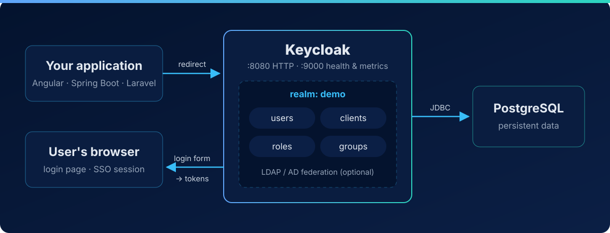

# How to install Keycloak

**Keycloak** is an open-source identity and access management server. It gives your applications
single sign-on, OAuth 2.0 / OpenID Connect, user federation (LDAP, Active Directory) and role
management, so your apps don't have to store passwords themselves.

By the end of this guide you will have:

- [x] Keycloak running locally
- [x] A **realm**, a **client** and a **user**
- [x] An access token returned by Keycloak


/// caption
What you're setting up: apps send users to Keycloak to log in, and Keycloak stores everything in PostgreSQL.
///

## Prerequisites

| Requirement | Version | Needed for |
|---|---|---|
| Docker or Podman | any recent | Options 1 and 2 |
| OpenJDK | 21 | Option 3 (Linux, no containers) |
| Free ports | `8080`, `9000` | HTTP and health endpoints |

!!! info "Which option should I pick?"
    - **Option 1** is the quickest way to try Keycloak. Data is lost when the container is removed.
    - **Option 2** keeps data in PostgreSQL and is the right base for a real server.
    - **Option 3** runs Keycloak directly on a Linux machine without containers.

## Step 1: Install and start Keycloak

=== "Option 1: Docker (quick start)"

    ```bash
    docker run --name keycloak -p 8080:8080 -p 9000:9000 \
      -e KC_BOOTSTRAP_ADMIN_USERNAME=admin \
      -e KC_BOOTSTRAP_ADMIN_PASSWORD=admin \
      -e KC_HEALTH_ENABLED=true \
      quay.io/keycloak/keycloak:26.4 start-dev
    ```

    `start-dev` runs Keycloak in development mode: plain HTTP, relaxed settings and an embedded
    database. Use it for learning and local testing only.

=== "Option 2: Docker Compose + PostgreSQL"

    Create a folder with this `compose.yaml`:

    ```yaml title="compose.yaml"
    services:
      postgres:
        image: postgres:17
        environment:
          POSTGRES_DB: keycloak
          POSTGRES_USER: keycloak
          POSTGRES_PASSWORD: change-me # (1)!
        volumes:
          - pgdata:/var/lib/postgresql/data
        healthcheck:
          test: ["CMD-SHELL", "pg_isready -U keycloak"]
          interval: 5s
          retries: 10

      keycloak:
        image: quay.io/keycloak/keycloak:26.4
        command: start-dev # (2)!
        environment:
          KC_DB: postgres
          KC_DB_URL: jdbc:postgresql://postgres:5432/keycloak
          KC_DB_USERNAME: keycloak
          KC_DB_PASSWORD: change-me
          KC_BOOTSTRAP_ADMIN_USERNAME: admin
          KC_BOOTSTRAP_ADMIN_PASSWORD: admin
          KC_HEALTH_ENABLED: "true"
        ports:
          - "8080:8080"
          - "9000:9000"
        depends_on:
          postgres:
            condition: service_healthy

    volumes:
      pgdata:
    ```

    1.  Use a strong password, ideally from a `.env` file that is not committed to git.
    2.  Switch to `start` for production, see [Going to production](#going-to-production).

    Start both containers:

    ```bash
    docker compose up -d
    docker compose logs -f keycloak
    ```

=== "Option 3: Linux (no containers)"

    ```bash
    # 1. Java 21 (RHEL / Fedora shown; use apt on Debian / Ubuntu)
    sudo dnf install -y java-21-openjdk

    # 2. Download and extract Keycloak
    KC_VERSION=26.4.0
    curl -LO https://github.com/keycloak/keycloak/releases/download/${KC_VERSION}/keycloak-${KC_VERSION}.tar.gz
    tar -xzf keycloak-${KC_VERSION}.tar.gz
    cd keycloak-${KC_VERSION}

    # 3. Start in development mode with a temporary admin user
    export KC_BOOTSTRAP_ADMIN_USERNAME=admin
    export KC_BOOTSTRAP_ADMIN_PASSWORD=admin
    bin/kc.sh start-dev --health-enabled=true
    ```

    !!! tip
        Check the [Keycloak releases page](https://github.com/keycloak/keycloak/releases) for the
        latest version number and change `KC_VERSION`.

Wait for a log line similar to:

```text
Keycloak 26.4.0 on JVM (powered by Quarkus) started in 6.512s. Listening on: http://0.0.0.0:8080
```

## Step 2: Check that Keycloak is healthy

```bash
curl -s http://localhost:9000/health/ready
```

Expected output:

```json
{ "status": "UP", "checks": [] }
```

## Step 3: Log in to the admin console

Open <http://localhost:8080/admin> and sign in with `admin` / `admin`.

<!-- SCREENSHOT: save as images/01-admin-login.png, then remove the comment markers below

/// caption
The admin console login page.
///
-->

!!! warning "Temporary admin"
    The bootstrap admin is meant to be temporary. After your first login, create a permanent
    admin user in the `master` realm and delete the bootstrap one.

## Step 4: Create a realm

A **realm** is an isolated space with its own users, clients and settings. Keep `master` for
administering Keycloak and create a separate realm for your applications.

1. Click the realm dropdown at the top left (it shows **master**).
2. Click **Create realm**.
3. Set **Realm name** to `demo` and click **Create**.

<!-- SCREENSHOT: images/02-create-realm.png

-->

## Step 5: Create a client

A **client** is an application that asks Keycloak to authenticate users.

1. In the `demo` realm, go to **Clients** → **Create client**.
2. **Client type:** `OpenID Connect`, **Client ID:** `demo-app`, then **Next**.
3. Leave **Client authentication** off (a public client) and enable **Direct access grants**
   so we can test with `curl` in Step 7. Click **Next**.
4. **Valid redirect URIs:** `http://localhost:3000/*` (your app's URL), then **Save**.

<!-- SCREENSHOT: images/03-create-client.png

-->

!!! note
    Direct access grants (the password grant) are used here only to test quickly. Real web apps
    should use the **Authorization Code flow with PKCE**.

## Step 6: Create a user

1. Go to **Users** → **Create new user**.
2. **Username:** `alice`, fill in email, first and last name, then **Create**.
3. Open the **Credentials** tab → **Set password**, enter a password and turn **Temporary** off.

<!-- SCREENSHOT: images/04-set-password.png

-->

## Step 7: Get an access token

```bash
curl -s -X POST http://localhost:8080/realms/demo/protocol/openid-connect/token \
  -d grant_type=password \
  -d client_id=demo-app \
  -d username=alice \
  -d password='your-password' | jq
```

You should get back an `access_token`, a `refresh_token` and an `expires_in` value. Paste the
access token into <https://jwt.io> to see its claims: `iss`, `preferred_username`, `realm_access`
and so on.

:material-check-circle:{ .bh-ok } **Done.** Keycloak is running and issuing tokens for your realm.

## Going to production

`start-dev` is not for production. For a real server, use `start` and configure a hostname and TLS:

=== "Keycloak terminates TLS"

    ```bash
    bin/kc.sh start \
      --hostname=https://sso.example.com \
      --https-certificate-file=/etc/keycloak/tls.crt \
      --https-certificate-key-file=/etc/keycloak/tls.key \
      --db=postgres --db-url=jdbc:postgresql://db:5432/keycloak \
      --db-username=keycloak --db-password=change-me
    ```

=== "Behind a reverse proxy (Nginx, OpenShift route)"

    ```bash
    bin/kc.sh start \
      --hostname=https://sso.example.com \
      --proxy-headers=xforwarded \
      --http-enabled=true \
      --db=postgres --db-url=jdbc:postgresql://db:5432/keycloak \
      --db-username=keycloak --db-password=change-me
    ```

Production checklist:

- [ ] Use PostgreSQL (or another supported database), never the embedded dev database
- [ ] Serve Keycloak over HTTPS only
- [ ] Replace the bootstrap admin with a permanent admin account
- [ ] Keep the management port `9000` internal (health and metrics only)
- [ ] Back up the database regularly

## Troubleshooting

??? question "Port 8080 is already in use"
    Map a different host port, for example `-p 8180:8080`, and open `http://localhost:8180`.

??? question "`HTTPS required` error when logging in"
    The `master` realm requires HTTPS for non-local addresses. Use `localhost` while testing, or set
    up TLS as shown in [Going to production](#going-to-production).

??? question "`invalid_grant` or `unauthorized_client` from the token endpoint"
    Check that **Direct access grants** is enabled on the client, the username and password are
    right, and the password is not marked **Temporary**.

## Next steps

- [Securing Spring Boot APIs with Keycloak](../../blog/posts/spring/spring-boot-keycloak.md)
- [Keycloak Laravel Auth](../../packages/keycloak-laravel-auth/index.md) for Laravel applications
- [Official Keycloak server guides](https://www.keycloak.org/guides#server)
