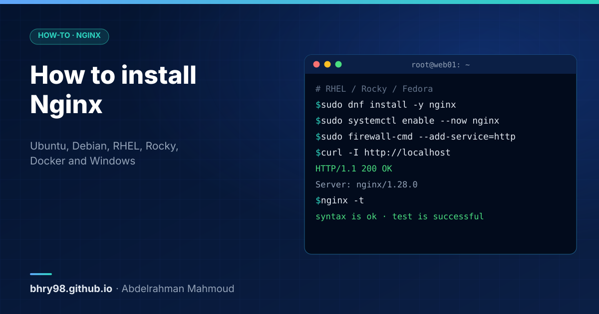

# How to install Nginx



!!! info "Before you start"
    New to Nginx? Read **[What is Nginx and why do we use it?](../../blog/posts/infrastructure/what-is-nginx.md)**
    first. It explains what a reverse proxy, load balancer and TLS termination are, which makes this
    guide and the next one much easier to follow.

This guide installs **Nginx Open Source** from the official `nginx.org` repository (newer than
most distribution packages), starts it as a service and checks that it serves a page.

By the end of this guide you will have:

- [x] Nginx installed and running as a service
- [x] Port 80 open in the firewall
- [x] Your own page served from `/var/www/example`
- [x] Know where the configuration files and logs are

## Prerequisites

| Requirement | Notes |
|---|---|
| A Linux server, a Docker host or a Windows machine | Ubuntu 22.04/24.04, Debian 12, RHEL/Rocky/Alma 9 or 10, Fedora |
| `sudo` access | Linux options |
| Free port `80` (and `443` later) | Stop Apache/IIS first if they use it |

!!! tip "Stable or mainline?"
    Nginx publishes two branches. **Stable** (even minor number, e.g. `1.28.x`) only receives
    critical fixes. **Mainline** (odd number, e.g. `1.29.x`) gets new features first. For servers,
    choose **stable**. It is the same idea as LTS, explained in
    [What does LTS mean?](../../blog/posts/fundamentals/what-does-lts-mean.md)

## Step 1: Install Nginx

=== "Ubuntu / Debian"

    ```bash
    # 1. Tools needed to add the repository
    sudo apt update
    sudo apt install -y curl gnupg2 ca-certificates lsb-release

    # 2. Import the official nginx signing key
    curl -fsSL https://nginx.org/keys/nginx_signing.key \
      | sudo gpg --dearmor -o /usr/share/keyrings/nginx-archive-keyring.gpg

    # 3. Add the stable repository (use "debian" instead of "ubuntu" on Debian)
    echo "deb [signed-by=/usr/share/keyrings/nginx-archive-keyring.gpg] \
    http://nginx.org/packages/ubuntu $(lsb_release -cs) nginx" \
      | sudo tee /etc/apt/sources.list.d/nginx.list

    # 4. Install
    sudo apt update
    sudo apt install -y nginx
    ```

    !!! note "Quick option"
        `sudo apt install nginx` without steps 1 to 3 also works, but installs the (older) version
        packaged by Ubuntu/Debian with a slightly different layout (`sites-available/`).

=== "RHEL / Rocky / Alma / Fedora"

    ```bash
    # 1. Add the official stable repository
    sudo tee /etc/yum.repos.d/nginx.repo > /dev/null <<'EOF'
    [nginx-stable]
    name=nginx stable repo
    baseurl=http://nginx.org/packages/centos/$releasever/$basearch/
    gpgcheck=1
    enabled=1
    gpgkey=https://nginx.org/keys/nginx_signing.key
    module_hotfixes=true
    EOF

    # 2. Install
    sudo dnf install -y nginx
    ```

    On Fedora, simply run `sudo dnf install -y nginx` (Fedora already ships recent versions).

=== "Docker / Podman"

    ```bash
    docker run -d --name nginx -p 8080:80 \
      -v "$PWD/html:/usr/share/nginx/html:ro" \
      nginx:stable-alpine
    ```

    Put an `index.html` in `./html` and open <http://localhost:8080>. With Docker you can skip
    Steps 2 and 3. If containers are new to you, read
    [Containers vs traditional deployment](../../blog/posts/devops/containers-vs-traditional-deployment.md).

    !!! tip "OpenShift / rootless"
        On OpenShift use `nginxinc/nginx-unprivileged`, which listens on `8080` and runs as a
        non-root user.

=== "Windows"

    1. Download the **Stable version** zip from <https://nginx.org/en/download.html>.
    2. Extract it to `C:\nginx`.
    3. Start it from PowerShell:

    ```powershell
    cd C:\nginx
    start nginx
    tasklist /fi "imagename eq nginx.exe"   # you should see two nginx.exe processes
    ```

    Stop it with `.\nginx.exe -s stop`, reload config with `.\nginx.exe -s reload`.

    !!! warning
        Nginx for Windows is fine for development and testing, but it is not built for production
        traffic (it uses `select()` and one worker). Use Linux for real servers.

Check the installed version:

```bash
nginx -v
```

```text
nginx version: nginx/1.28.0
```

## Step 2: Start Nginx and enable it at boot

```bash
sudo systemctl enable --now nginx
sudo systemctl status nginx --no-pager
```

You should see `active (running)`.

## Step 3: Open the firewall

=== "firewalld (RHEL family)"

    ```bash
    sudo firewall-cmd --permanent --add-service=http --add-service=https
    sudo firewall-cmd --reload
    ```

=== "ufw (Ubuntu)"

    ```bash
    sudo ufw allow 'Nginx Full'   # or: sudo ufw allow 80,443/tcp
    sudo ufw status
    ```

!!! warning "SELinux (RHEL / Rocky / Fedora)"
    SELinux stays **enforcing**. Don't disable it. If Nginx must proxy to an app port later, allow it with
    `sudo setsebool -P httpd_can_network_connect 1`. If you serve files from a custom folder, label it:
    `sudo semanage fcontext -a -t httpd_sys_content_t "/var/www(/.*)?" && sudo restorecon -Rv /var/www`.

## Step 4: Check the default page

```bash
curl -I http://localhost
```

```text
HTTP/1.1 200 OK
Server: nginx/1.28.0
Content-Type: text/html
```

Open `http://<server-ip>/` in a browser and you should see **Welcome to nginx!**

## Step 5: Serve your own site

Create the content:

```bash
sudo mkdir -p /var/www/example
echo '<h1>Hello from Nginx</h1>' | sudo tee /var/www/example/index.html
```

Create a server block. With the nginx.org packages, every `*.conf` file in `/etc/nginx/conf.d/` is
loaded automatically:

```nginx title="/etc/nginx/conf.d/example.conf"
server {
    listen 80;
    server_name example.local;      # your domain or the server IP

    root  /var/www/example;
    index index.html;

    access_log /var/log/nginx/example.access.log;
    error_log  /var/log/nginx/example.error.log;

    location / {
        try_files $uri $uri/ =404;
    }
}
```

Test the configuration, then reload **without** dropping connections:

```bash
sudo nginx -t
sudo systemctl reload nginx
curl -H "Host: example.local" http://localhost
```

```text
<h1>Hello from Nginx</h1>
```

:material-check-circle:{ .bh-ok } **Done.** Nginx is installed, starts at boot and serves your site.

## Where things live

| Path | What it is |
|---|---|
| `/etc/nginx/nginx.conf` | Main configuration (workers, logging, `include` lines) |
| `/etc/nginx/conf.d/*.conf` | Your server blocks (nginx.org packages, RHEL) |
| `/etc/nginx/sites-available/` + `sites-enabled/` | Server blocks on Debian/Ubuntu distro packages |
| `/usr/share/nginx/html` | Default welcome page |
| `/var/log/nginx/access.log`, `error.log` | Logs |

Useful commands:

```bash
sudo nginx -t                 # test config (always before reload)
sudo nginx -T                 # print the full, merged configuration
sudo systemctl reload nginx   # apply config with zero downtime
sudo tail -f /var/log/nginx/error.log
```

## Troubleshooting

??? question "`bind() to 0.0.0.0:80 failed (98: Address already in use)`"
    Another program uses port 80 (often Apache or another Nginx). Find it with
    `sudo ss -ltnp | grep ':80 '`, stop it, then start Nginx again.

??? question "`403 Forbidden`"
    Nginx can't read the files. Check permissions (`namei -l /var/www/example/index.html`),
    make sure there is an `index.html`, and on RHEL check the SELinux label (see Step 3).

??? question "Works with `curl localhost` but not from another machine"
    The firewall (Step 3) or a cloud security group is blocking port 80.

??? question "`502 Bad Gateway` when proxying to an app"
    The backend app is not running or not reachable. On RHEL, also run
    `sudo setsebool -P httpd_can_network_connect 1`.

## Next steps

- [How to configure Nginx as a reverse proxy, load balancer and HA pair](nginx-reverse-proxy-load-balancing-ha.md)
- [What is Nginx and why do we use it?](../../blog/posts/infrastructure/what-is-nginx.md)
- [Official Nginx documentation](https://nginx.org/en/docs/)
