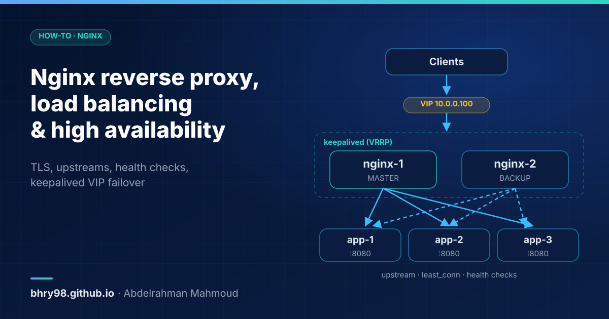
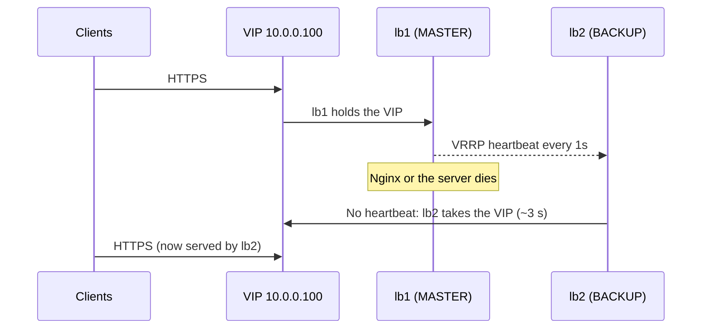

# How to configure Nginx as a reverse proxy, load balancer and HA pair



!!! info "Before you start"
    - Understand **[what Nginx is and why we use it](../../blog/posts/infrastructure/what-is-nginx.md)**
      (reverse proxy, load balancer, TLS termination).
    - Have Nginx installed on two servers: **[How to install Nginx](install-nginx.md)**.

This guide builds the setup in the picture, one layer at a time. Each step works on its own, so
you can stop after the reverse proxy if that is all you need.

By the end of this guide you will have:

- [x] Nginx proxying HTTPS traffic to a backend application
- [x] Traffic load balanced across three app servers, with failover
- [x] Two Nginx servers sharing a **virtual IP** with keepalived, so one can die without downtime

## Lab used in this guide

| Host | IP | Role |
|---|---|---|
| `lb1` | `10.0.0.21` | Nginx + keepalived (MASTER) |
| `lb2` | `10.0.0.22` | Nginx + keepalived (BACKUP) |
| VIP | `10.0.0.100` | Floating IP, DNS `app.bhry98.local` points here |
| `app1` to `app3` | `10.0.0.11` to `.13` | Your application on port `8080` |

!!! tip "No app to test with?"
    Run a tiny echo server on each app host, it prints which host answered:
    `docker run -d -p 8080:8080 --name echo hashicorp/http-echo -listen=:8080 -text="hello from $(hostname)"`

## Step 1: A simple reverse proxy

On `lb1`, create a server block that forwards everything to one app server:

```nginx title="/etc/nginx/conf.d/app.conf"
server {
    listen 80;
    server_name app.bhry98.local;

    location / {
        proxy_pass http://10.0.0.11:8080;

        # Tell the app who the real client is and what URL was requested
        proxy_set_header Host              $host;
        proxy_set_header X-Real-IP         $remote_addr;
        proxy_set_header X-Forwarded-For   $proxy_add_x_forwarded_for;
        proxy_set_header X-Forwarded-Proto $scheme;
    }
}
```

```bash
sudo nginx -t && sudo systemctl reload nginx
curl -H "Host: app.bhry98.local" http://10.0.0.21/
```

!!! warning "RHEL / Rocky: 502 Bad Gateway?"
    SELinux blocks Nginx from opening network connections by default. Allow it once:
    `sudo setsebool -P httpd_can_network_connect 1`

!!! note "Why the `X-Forwarded-*` headers matter"
    Without them, your app sees every request as coming from the proxy's IP over plain HTTP. Spring
    Boot reads them with `server.forward-headers-strategy=framework`; Keycloak with
    `--proxy-headers=xforwarded`.

## Step 2: Load balance across several servers

Replace the single address with an **upstream** group:

```nginx title="/etc/nginx/conf.d/app.conf"
upstream app_backend {
    least_conn;                                  # (1)!
    server 10.0.0.11:8080 max_fails=3 fail_timeout=30s;  # (2)!
    server 10.0.0.12:8080 max_fails=3 fail_timeout=30s;
    server 10.0.0.13:8080 max_fails=3 fail_timeout=30s;
    # server 10.0.0.14:8080 backup;              # (3)!

    keepalive 32;                                # (4)!
}

server {
    listen 80;
    server_name app.bhry98.local;

    location / {
        proxy_pass http://app_backend;
        proxy_http_version 1.1;
        proxy_set_header Connection "";

        proxy_set_header Host              $host;
        proxy_set_header X-Real-IP         $remote_addr;
        proxy_set_header X-Forwarded-For   $proxy_add_x_forwarded_for;
        proxy_set_header X-Forwarded-Proto $scheme;

        # Retry another server when one fails
        proxy_next_upstream error timeout http_502 http_503 http_504;
        proxy_connect_timeout 3s;
        proxy_read_timeout    60s;
    }
}
```

1.  Send each request to the server with the fewest active connections. Remove it for plain
    **round robin** (the default).
2.  **Passive health check**: after 3 failures, the server is skipped for 30 seconds.
3.  A `backup` server only gets traffic when all the others are down.
4.  Reuse connections to the backends instead of opening a new TCP connection per request.
    Needs `proxy_http_version 1.1` and an empty `Connection` header.

Test it. The answers should rotate between `app1`, `app2` and `app3`:

```bash
for i in $(seq 6); do curl -s -H "Host: app.bhry98.local" http://10.0.0.21/; done
```

Stop the app on `app2` and run the loop again: requests keep succeeding on the other two.

### Choosing a load balancing method

| Directive | How it picks a server | Use it when |
|---|---|---|
| *(none)* | Round robin, optional `weight=` | Requests cost about the same |
| `least_conn` | Fewest active connections | Requests have very different durations |
| `ip_hash` | Same client IP always goes to the same server | Your app keeps **sessions in memory** |
| `hash $cookie_JSESSIONID consistent` | By any key | Sticky sessions without IP issues behind NAT |

!!! tip
    Sticky sessions are a workaround. If you can, store sessions in Redis or a database, or use
    stateless JWT tokens, so any server can answer any request.

## Step 3: Add HTTPS

Put the certificate and key on the load balancer (from your CA, Let's Encrypt, or a self-signed one
for the lab):

```bash
# Lab only: self-signed certificate
sudo mkdir -p /etc/nginx/tls
sudo openssl req -x509 -nodes -newkey rsa:2048 -days 365 \
  -keyout /etc/nginx/tls/app.key -out /etc/nginx/tls/app.crt \
  -subj "/CN=app.bhry98.local" -addext "subjectAltName=DNS:app.bhry98.local"
```

```nginx title="/etc/nginx/conf.d/app.conf (server blocks)"
# Redirect all HTTP to HTTPS
server {
    listen 80;
    server_name app.bhry98.local;
    return 301 https://$host$request_uri;
}

server {
    listen 443 ssl;
    http2 on;
    server_name app.bhry98.local;

    ssl_certificate     /etc/nginx/tls/app.crt;
    ssl_certificate_key /etc/nginx/tls/app.key;
    ssl_protocols       TLSv1.2 TLSv1.3;
    ssl_session_cache   shared:SSL:10m;
    ssl_session_timeout 1d;

    add_header Strict-Transport-Security "max-age=31536000" always;
    add_header X-Content-Type-Options nosniff always;
    add_header X-Frame-Options SAMEORIGIN always;
    server_tokens off;                       # hide the Nginx version

    client_max_body_size 20m;                # max upload size

    location / {
        proxy_pass http://app_backend;
        proxy_http_version 1.1;
        proxy_set_header Connection "";
        proxy_set_header Host              $host;
        proxy_set_header X-Real-IP         $remote_addr;
        proxy_set_header X-Forwarded-For   $proxy_add_x_forwarded_for;
        proxy_set_header X-Forwarded-Proto $scheme;
        proxy_next_upstream error timeout http_502 http_503 http_504;
    }

    # Don't expose management endpoints to the internet
    location /actuator/ {
        deny all;
    }
}
```

```bash
sudo nginx -t && sudo systemctl reload nginx
curl -k -I https://10.0.0.21/ -H "Host: app.bhry98.local"
```

## Step 4: Common proxy recipes

=== "WebSockets"

    ```nginx
    location /ws/ {
        proxy_pass http://app_backend;
        proxy_http_version 1.1;
        proxy_set_header Upgrade $http_upgrade;
        proxy_set_header Connection "upgrade";
        proxy_read_timeout 1h;
    }
    ```

=== "Path-based routing"

    ```nginx
    location /api/  { proxy_pass http://app_backend; }      # keeps /api/ in the path
    location /auth/ { proxy_pass http://10.0.0.30:8080/; }  # trailing / strips /auth/
    location /      { root /var/www/frontend; try_files $uri /index.html; }  # SPA
    ```

=== "Rate limiting"

    ```nginx
    # in the http {} context (e.g. top of conf.d/app.conf)
    limit_req_zone $binary_remote_addr zone=api:10m rate=20r/s;

    location /api/ {
        limit_req zone=api burst=40 nodelay;
        limit_req_status 429;
        proxy_pass http://app_backend;
    }
    ```

=== "Response caching"

    ```nginx
    # in the http {} context
    proxy_cache_path /var/cache/nginx/app levels=1:2 keys_zone=app_cache:10m
                     max_size=1g inactive=60m use_temp_path=off;

    location /api/catalog/ {
        proxy_cache app_cache;
        proxy_cache_valid 200 5m;
        proxy_cache_use_stale error timeout updating http_502 http_503;
        add_header X-Cache-Status $upstream_cache_status;
        proxy_pass http://app_backend;
    }
    ```

=== "TCP / database (stream)"

    ```nginx
    # in /etc/nginx/nginx.conf, at the top level (not inside http {})
    stream {
        upstream postgres {
            server 10.0.0.41:5432;
            server 10.0.0.42:5432 backup;
        }
        server {
            listen 5432;
            proxy_pass postgres;
        }
    }
    ```

## Step 5: High availability with keepalived

So far `lb1` is a single point of failure. Now copy the **same** Nginx configuration to `lb2`
(`/etc/nginx/conf.d/` and `/etc/nginx/tls/`), then let **keepalived** float a virtual IP between
them using VRRP. Clients and DNS only know the VIP `10.0.0.100`.



Install keepalived on **both** servers:

```bash
sudo dnf install -y keepalived      # RHEL family
# sudo apt install -y keepalived    # Ubuntu / Debian
```

Create a health check script that fails when Nginx is not answering:

```bash title="/etc/keepalived/check_nginx.sh"
#!/bin/sh
# Exit non-zero if nginx is down, so keepalived moves the VIP away.
pidof nginx > /dev/null || exit 1
curl -fsk -o /dev/null --max-time 2 https://127.0.0.1/ -H "Host: app.bhry98.local" || exit 1
```

```bash
sudo chmod +x /etc/keepalived/check_nginx.sh
```

=== "lb1 (MASTER)"

    ```conf title="/etc/keepalived/keepalived.conf"
    global_defs {
        router_id lb1
        enable_script_security
        script_user root
    }

    vrrp_script chk_nginx {
        script "/etc/keepalived/check_nginx.sh"
        interval 2
        fall 2
        rise 2
    }

    vrrp_instance VI_APP {
        state MASTER
        interface eth0              # your NIC name: ip -br a
        virtual_router_id 51        # same on both, unique per network
        priority 150                # higher wins
        advert_int 1
        authentication {
            auth_type PASS
            auth_pass Bhry98Vp      # same on both, max 8 characters
        }
        unicast_src_ip 10.0.0.21
        unicast_peer {
            10.0.0.22
        }
        virtual_ipaddress {
            10.0.0.100/24
        }
        track_script {
            chk_nginx
        }
    }
    ```

=== "lb2 (BACKUP)"

    ```conf title="/etc/keepalived/keepalived.conf"
    global_defs {
        router_id lb2
        enable_script_security
        script_user root
    }

    vrrp_script chk_nginx {
        script "/etc/keepalived/check_nginx.sh"
        interval 2
        fall 2
        rise 2
    }

    vrrp_instance VI_APP {
        state BACKUP
        interface eth0
        virtual_router_id 51
        priority 100
        advert_int 1
        authentication {
            auth_type PASS
            auth_pass Bhry98Vp
        }
        unicast_src_ip 10.0.0.22
        unicast_peer {
            10.0.0.21
        }
        virtual_ipaddress {
            10.0.0.100/24
        }
        track_script {
            chk_nginx
        }
    }
    ```

Allow VRRP between the two servers and start keepalived:

```bash
# firewalld: allow the VRRP protocol (112)
sudo firewall-cmd --permanent --add-rich-rule='rule protocol value="vrrp" accept'
sudo firewall-cmd --reload

# Let Nginx bind to the VIP even on the server that doesn't hold it yet
echo 'net.ipv4.ip_nonlocal_bind = 1' | sudo tee /etc/sysctl.d/99-nonlocal-bind.conf
sudo sysctl --system

sudo systemctl enable --now keepalived
```

!!! note "Cloud networks"
    AWS, Azure and GCP don't allow a floating IP via VRRP/ARP. Use the provider's load balancer
    (ALB, Azure LB) in front of two Nginx servers instead. That provides the same HA.

## Verify it works

Check who holds the VIP:

```bash
ip -br a | grep 10.0.0.100      # should appear on lb1 only
```

From a client, send requests in a loop:

```bash
while true; do curl -sk https://app.bhry98.local/ --resolve app.bhry98.local:443:10.0.0.100; sleep 0.5; done
```

Now, on `lb1`, simulate a failure:

```bash
sudo systemctl stop nginx
```

Within about 3 seconds, `ip -br a` shows the VIP on `lb2`, and the client loop keeps getting
answers (maybe one failed request during the switch). Start Nginx on `lb1` again and the VIP moves
back because `lb1` has the higher priority.

```bash
sudo journalctl -u keepalived -f    # watch "Entering MASTER STATE" / "Entering BACKUP STATE"
```

:material-check-circle:{ .bh-ok } **Done.** You have HTTPS termination, load balancing with
failover across app servers, and no single point of failure at the load balancer layer.

## Production checklist

- [ ] Same Nginx config on both load balancers (keep it in Git and deploy with Ansible or similar)
- [ ] `nginx -t` in your deployment pipeline before every reload
- [ ] Real certificates, automatic renewal, and monitoring of expiry dates
- [ ] `/actuator`, `/admin` and similar paths blocked or restricted by IP
- [ ] Access logs shipped to a central place (ELK, Loki, Splunk)
- [ ] Alerts on keepalived state changes and on `5xx` rates

## Troubleshooting

??? question "`502 Bad Gateway`"
    The backend is down, on the wrong port, or (RHEL) SELinux blocks the connection:
    `sudo setsebool -P httpd_can_network_connect 1`. Check `/var/log/nginx/error.log`.

??? question "`504 Gateway Timeout`"
    The backend is too slow. Raise `proxy_read_timeout` for that `location`, or fix the slow endpoint.

??? question "Both servers hold the VIP (split brain)"
    The servers can't see each other's VRRP packets. Allow protocol 112 in the firewall, check
    `virtual_router_id` and `auth_pass` are identical, and that `unicast_peer` IPs are right.

??? question "App generates `http://` links or redirect loops behind the proxy"
    The app doesn't trust `X-Forwarded-Proto`. In Spring Boot set
    `server.forward-headers-strategy=framework`.

## Next steps

- [What is Nginx and why do we use it?](../../blog/posts/infrastructure/what-is-nginx.md)
- [How to install Keycloak](../keycloak/install-keycloak.md) and put it behind this Nginx
- [Nginx HTTP load balancing docs](https://nginx.org/en/docs/http/load_balancing.html) ·
  [keepalived docs](https://keepalived.readthedocs.io/)
