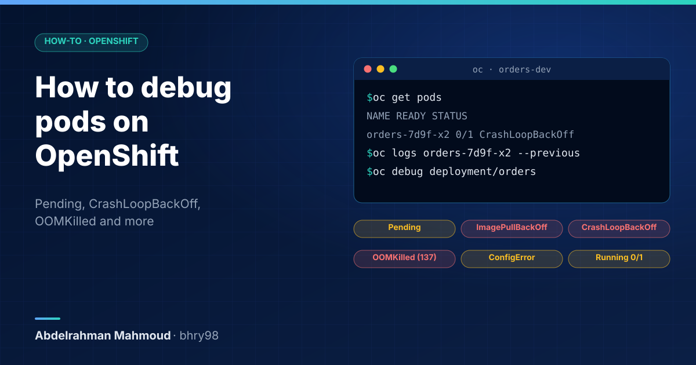

# How to debug pods on OpenShift



!!! info "Before you start"
    - New to OpenShift? Read [OpenShift is not just Kubernetes](../../blog/posts/openshift/openshift-vs-kubernetes.md).
    - New to containers in general? Read [Containers vs traditional deployment](../../blog/posts/devops/containers-vs-traditional-deployment.md).

When a pod is unhappy, OpenShift almost always tells you why. The trick is knowing which command
shows the answer for which status. This is the playbook I follow, from the first command to the
cluster-level tools.

By the end of this guide you will be able to:

- [x] Find out why a pod is failing in under a minute
- [x] Fix the eight most common pod problems
- [x] Get a shell inside a crashing container with `oc debug`
- [x] Collect data for a Red Hat support case

## Prerequisites

| Requirement | Notes |
|---|---|
| `oc` CLI | Logged in with `oc login` |
| Access to the project | `edit` or `admin` role; node steps need `cluster-admin` |

## Step 1: Always start with these three commands

```bash
oc get pods -o wide
oc describe pod <pod>                         # read the Events section at the bottom
oc get events --sort-by=.lastTimestamp | tail -20
```

`describe` answers most questions on its own. The **STATUS** column tells you which of the next
sections to follow.

## Step 2: Fix the problem by status

### `Pending`: the pod was never scheduled

```bash
oc describe pod <pod> | sed -n '/Events/,$p'
oc describe quota
oc get limitrange
oc get pvc
```

| Event message | Meaning | Fix |
|---|---|---|
| `Insufficient cpu` / `memory` | No node has room for your **requests** | Lower requests or add capacity |
| `exceeded quota` | The project's ResourceQuota is full | Raise quota or remove old workloads |
| `pod has unbound immediate PersistentVolumeClaims` | PVC not bound | Check StorageClass / `oc get pvc` |
| `didn't match Pod's node affinity/selector` | No node has that label | Fix the selector or label a node |

### `ImagePullBackOff` / `ErrImagePull`

```bash
oc describe pod <pod> | grep -A5 "Failed"
```

- **`manifest unknown` / `not found`**: wrong image name or tag.
- **`unauthorized`**: private registry without credentials:

    ```bash
    oc create secret docker-registry nexus-pull \
      --docker-server=nexus.example.com:8443 \
      --docker-username=ci --docker-password='***'
    oc secrets link default nexus-pull --for=pull
    ```

- **`x509: certificate signed by unknown authority`**: the cluster does not trust your registry's CA.
  An admin adds it via `image.config.openshift.io/cluster` (`additionalTrustedCA`).

### `CrashLoopBackOff`: it starts, then dies

The current container has probably just restarted, so its logs are empty. Read the **previous** one:

```bash
oc logs <pod> --previous
oc logs <pod> -c <container> --previous   # multi-container pods
```

Typical causes: a missing environment variable or config, can't reach the database, **permission
denied** (see [Why your container fails on OpenShift](../../blog/posts/openshift/openshift-scc-arbitrary-uid.md)),
or the **liveness probe** killing a slow-starting app.

When the container dies too fast to inspect, start a copy of it with a shell instead of its normal
command:

```bash
oc debug deployment/orders-api
# inside: same image, env, volumes and SCC, but runs /bin/sh
env | sort
ls -la /app
java -jar /app/app.jar        # run it by hand and watch it fail
```

!!! tip
    `oc debug` is the single most useful command on this page.

### `OOMKilled` (exit code 137)

```bash
oc describe pod <pod> | grep -A3 "Last State"
#   Last State: Terminated
#     Reason:   OOMKilled
#     Exit Code: 137
oc adm top pods
```

The container used more memory than its **limit**. For Java, make the heap follow the limit with
`-XX:MaxRAMPercentage=75` (details in [Running Spring Boot on OpenShift](../../blog/posts/spring/spring-boot-on-openshift.md)),
then raise the limit only if real usage needs it.

### `CreateContainerConfigError`

A referenced **ConfigMap or Secret** (or a key inside it) does not exist:

```bash
oc describe pod <pod> | grep -i "configmap\|secret"
oc get configmap,secret
```

### `Running` but `0/1 READY`

The app is up but the **readiness probe** fails, so the Service sends it no traffic (and the Route
shows *Application is not available*).

```bash
oc describe pod <pod> | grep -A3 Readiness
oc rsh <pod> curl -s localhost:8080/actuator/health/readiness
oc get endpoints <service>      # empty = no Ready pods behind the Service
```

Wrong path, wrong port, or a dependency the readiness check waits for. For Route-specific issues,
see [OpenShift Routes explained](../../blog/posts/openshift/openshift-routes-tls.md).

## Step 3: Look inside a running pod

```bash
oc rsh <pod>                                   # interactive shell
oc exec <pod> -- cat /app/config/application.yaml
oc cp <pod>:/tmp/heapdump.hprof ./heapdump.hprof
oc port-forward <pod> 5005:5005                # attach a remote debugger locally
```

## Step 4: When it's not your app (node and cluster)

These need `cluster-admin`.

```bash
oc get nodes
oc adm top nodes
oc get clusteroperators                        # any DEGRADED=True?

oc debug node/<node>                           # privileged pod on the node
chroot /host
crictl ps | grep orders                        # containers as the runtime sees them
journalctl -u kubelet --since "10 min ago"
```

Opening a Red Hat support case? Collect everything at once:

```bash
oc adm must-gather            # cluster data into ./must-gather.local.*
oc adm inspect ns/orders-dev  # just one namespace
```

:material-check-circle:{ .bh-ok } **Done.** You can now go from a red pod to the root cause with a
handful of `oc` commands.

## Cheat sheet

| Symptom | First command |
|---|---|
| `Pending` | `oc describe pod`, `oc describe quota` |
| `ImagePullBackOff` | `oc describe pod`, check pull secret |
| `CrashLoopBackOff` | `oc logs --previous`, then `oc debug` |
| `OOMKilled` (137) | `oc describe pod`, `oc adm top pods` |
| `CreateContainerConfigError` | `oc get configmap,secret` |
| Running, not Ready | readiness probe path / port |
| Route shows "not available" | `oc get endpoints` |
| Node problems | `oc debug node/…`, `oc get co` |

Save this table. Most incidents are one of these eight rows.

## Next steps

- [Building Spring Boot images for OpenShift](../../blog/posts/spring/spring-boot-openshift-builds.md)
- [Why your container fails on OpenShift (SCC and random UIDs)](../../blog/posts/openshift/openshift-scc-arbitrary-uid.md)
- [OpenShift docs: Investigating pod issues](https://docs.redhat.com/en/documentation/openshift_container_platform/latest/html/support/troubleshooting)
