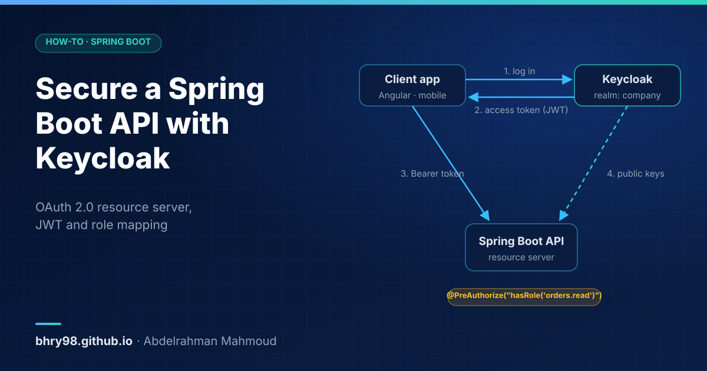
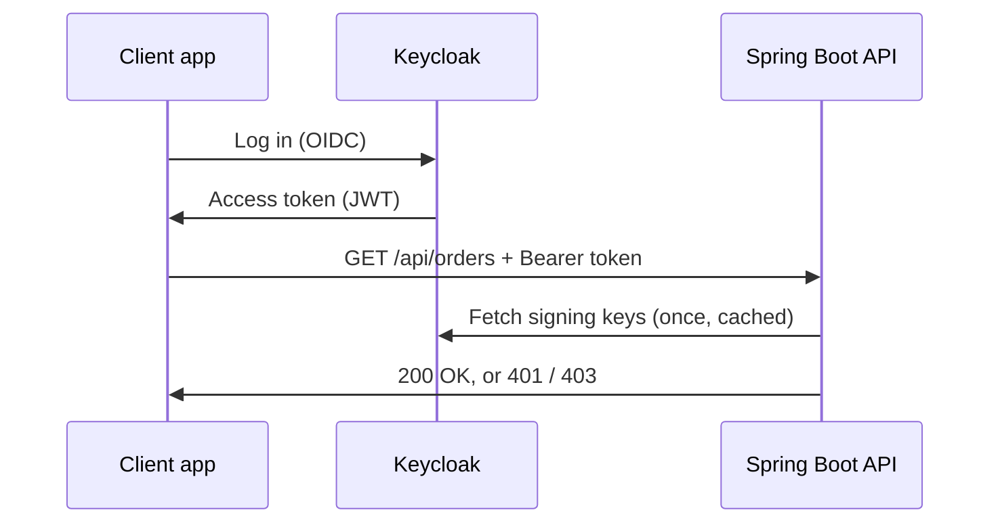

# How to secure a Spring Boot API with Keycloak



!!! info "Before you start"
    - You need a running Keycloak: **[How to install Keycloak](../keycloak/install-keycloak.md)**.
    - You need a Spring Boot API to protect: **[How to create a simple CRUD API in Spring Boot](simple-crud.md)**.

When an organization runs many services, each one managing its own users quickly becomes a
security problem. **Keycloak** centralizes authentication; your Spring Boot APIs only need to
**check the token** that comes with each request. They never see a password.

By the end of this guide you will have:

- [x] Keycloak roles `orders.read` and `orders.write` assigned to a user
- [x] A Spring Boot API that rejects requests without a valid token (`401`)
- [x] Role checks with `@PreAuthorize` (`403` when the role is missing)
- [x] A tested flow with `curl`

## How it fits together



## Prerequisites

| Requirement | Version |
|---|---|
| Keycloak | 24+ (this guide uses realm `demo` at `http://localhost:8080`) |
| Java | 17 or 21 ([which JDK?](../../blog/posts/java/jdk-vs-jre-vs-jvm.md)) |
| Spring Boot | 3.x |
| `curl` and `jq` | for testing |

## Step 1: Configure Keycloak

In the `demo` realm:

1. **Realm roles** → **Create role**: `orders.read`, then again for `orders.write`.
2. **Users** → `alice` → **Role mapping** → **Assign role** → select `orders.read`.
   (Leave `orders.write` unassigned so we can test a `403`.)
3. **Clients** → **Create client**:
    - `orders-ui`: *OpenID Connect*, **public** client, **Standard flow** (your front end, with PKCE).
    - For testing in this guide, also enable **Direct access grants** on it so `curl` can get a token.

!!! tip "Users in Active Directory?"
    Add **User federation** → **LDAP** in the realm and map AD groups to roles. Secure that
    connection with LDAPS: [How to secure Active Directory with LDAPS](../active-directory/enable-ldaps-active-directory.md).

## Step 2: Make the API an OAuth 2.0 resource server

Add the dependency:

```xml title="pom.xml"
<dependency>
  <groupId>org.springframework.boot</groupId>
  <artifactId>spring-boot-starter-oauth2-resource-server</artifactId>
</dependency>
```

Point it at the realm:

```yaml title="src/main/resources/application.yml"
spring:
  security:
    oauth2:
      resourceserver:
        jwt:
          issuer-uri: http://localhost:8080/realms/demo
```

With `issuer-uri` set, Spring downloads Keycloak's public keys and checks every token's
**signature**, **expiry** and **issuer** automatically.

## Step 3: Map Keycloak roles to Spring authorities

Keycloak puts realm roles in a `realm_access.roles` claim, which Spring does not read by default.
This configuration fixes that and secures every endpoint:

```java title="SecurityConfig.java"
@Configuration
@EnableMethodSecurity
class SecurityConfig {

    @Bean
    SecurityFilterChain api(HttpSecurity http) throws Exception {
        http
            .authorizeHttpRequests(auth -> auth
                .requestMatchers("/actuator/health/**").permitAll()
                .anyRequest().authenticated())
            .oauth2ResourceServer(oauth -> oauth
                .jwt(jwt -> jwt.jwtAuthenticationConverter(keycloakRoles())))
            .sessionManagement(s -> s.sessionCreationPolicy(SessionCreationPolicy.STATELESS))
            .csrf(csrf -> csrf.disable()); // stateless API with bearer tokens, no cookies
        return http.build();
    }

    private JwtAuthenticationConverter keycloakRoles() {
        var converter = new JwtAuthenticationConverter();
        converter.setJwtGrantedAuthoritiesConverter(jwt -> {
            Map<String, Object> realmAccess = jwt.getClaimAsMap("realm_access");
            if (realmAccess == null) return List.of();
            @SuppressWarnings("unchecked")
            var roles = (Collection<String>) realmAccess.getOrDefault("roles", List.of());
            return roles.stream()
                .map(role -> (GrantedAuthority) new SimpleGrantedAuthority("ROLE_" + role))
                .toList();
        });
        converter.setPrincipalClaimName("preferred_username");
        return converter;
    }
}
```

## Step 4: Protect endpoints with roles

Authorization now reads like the business rules:

```java title="OrderController.java"
@RestController
@RequestMapping("/api/orders")
class OrderController {

    @GetMapping
    @PreAuthorize("hasRole('orders.read')")
    List<Order> list() { ... }

    @PostMapping
    @PreAuthorize("hasRole('orders.write')")
    Order create(@RequestBody @Valid Order order) { ... }

    @GetMapping("/me")
    Map<String, Object> me(@AuthenticationPrincipal Jwt jwt) {
        return Map.of("user", jwt.getClaimAsString("preferred_username"));
    }
}
```

Start the API on port `8081` (Keycloak already uses 8080):

```bash
./mvnw spring-boot:run -Dspring-boot.run.arguments=--server.port=8081
```

## Verify it works

**No token → 401:**

```bash
curl -i http://localhost:8081/api/orders
```

```text
HTTP/1.1 401
WWW-Authenticate: Bearer
```

**Get a token for `alice`:**

```bash
TOKEN=$(curl -s -X POST http://localhost:8080/realms/demo/protocol/openid-connect/token \
  -d grant_type=password -d client_id=orders-ui \
  -d username=alice -d password='your-password' | jq -r .access_token)
```

**With token and the `orders.read` role → 200:**

```bash
curl -i -H "Authorization: Bearer $TOKEN" http://localhost:8081/api/orders
```

**Without the `orders.write` role → 403:**

```bash
curl -i -X POST -H "Authorization: Bearer $TOKEN" -H "Content-Type: application/json" \
  -d '{"product":"book","quantity":1}' http://localhost:8081/api/orders
```

```text
HTTP/1.1 403
```

Assign `orders.write` to `alice` in Keycloak, get a new token, and the `POST` succeeds.

:material-check-circle:{ .bh-ok } **Done.** Your API trusts Keycloak tokens and enforces roles.

## Service-to-service calls

For backend-to-backend calls, use the **client credentials** grant: create a *confidential* client
with **Service accounts roles** enabled, give that service account its own roles, and the calling
service gets its own token. Every call is authenticated and auditable.

```bash
curl -s -X POST http://localhost:8080/realms/demo/protocol/openid-connect/token \
  -d grant_type=client_credentials -d client_id=billing-service -d client_secret=*** | jq .
```

## Mistakes I see most often

- **Wildcard redirect URIs** such as `*` on clients. Always list exact URLs.
- **Not checking the audience** when many clients share a realm. Add an *audience* mapper in
  Keycloak and validate `aud` in the API.
- **Long-lived access tokens.** Keep them short (minutes) and rely on refresh tokens.
- **Using the password grant in real apps.** It's only for testing here; front ends must use the
  **Authorization Code flow with PKCE**.
- **Doing all authorization in Keycloak.** Use roles as input, but keep business rules such as
  "a user can only see their own orders" in the service.

## Troubleshooting

??? question "Every request returns 401, even with a token"
    The token's `iss` claim must exactly match `issuer-uri`. A token requested via
    `http://127.0.0.1:8080` has a different issuer than `http://localhost:8080`. Decode the token on
    <https://jwt.io> and compare.

??? question "403 although the user has the role"
    Check the roles are **realm** roles (in `realm_access`), not client roles (in
    `resource_access.<client>.roles`), and that you request a **new** token after changing roles.

??? question "API fails to start: `Unable to resolve the Configuration with the provided Issuer`"
    The API can't reach Keycloak at startup. Check the URL and that Keycloak is running, or use
    `jwk-set-uri` instead of `issuer-uri`.

## Next steps

- [Running Spring Boot on OpenShift](../../blog/posts/spring/spring-boot-on-openshift.md)
- [Put Keycloak and the API behind Nginx with HTTPS](../nginx/nginx-reverse-proxy-load-balancing-ha.md)
- [Spring Security: OAuth 2.0 Resource Server reference](https://docs.spring.io/spring-security/reference/servlet/oauth2/resource-server/jwt.html)
