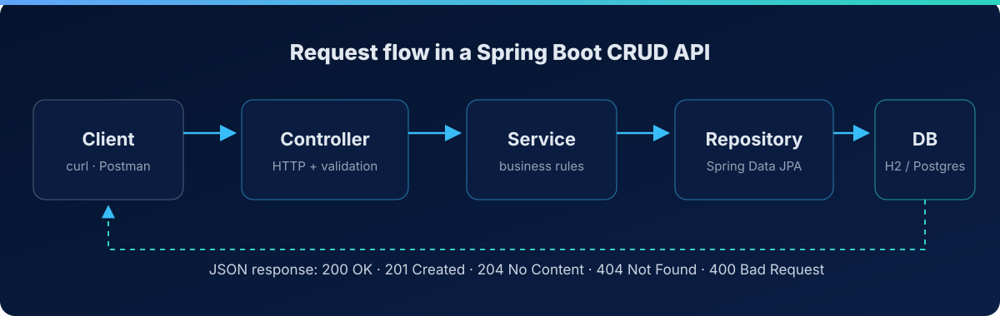

# How to create a simple CRUD API in Spring Boot

**CRUD** means **C**reate, **R**ead, **U**pdate and **D**elete, the four operations almost every
business application needs. In this guide you'll build a small REST API that manages **products**,
using a clean structure you can copy into real projects.

By the end of this guide you will have:

- [x] A Spring Boot project with Web, Data JPA and Validation
- [x] A `Product` entity stored in a database
- [x] REST endpoints for create, list, get, update and delete
- [x] Input validation and proper HTTP status codes


/// caption
Each layer has one job. The controller handles HTTP, the service holds business rules, and the
repository talks to the database.
///

## Prerequisites

| Requirement | Version |
|---|---|
| JDK | 21 or newer |
| Spring Boot | 3.x or 4.x (the code is the same) |
| An IDE | IntelliJ IDEA, VS Code or Eclipse |
| `curl` or Postman | to test the API |

## Step 1: Generate the project

Go to <https://start.spring.io> and choose:

| Field | Value |
|---|---|
| Project | Maven |
| Language | Java |
| Group | `com.example` |
| Artifact | `products` |
| Java | 21 |
| Dependencies | **Spring Web**, **Spring Data JPA**, **Validation**, **H2 Database** |

Click **Generate**, unzip the file and open the folder in your IDE.

<!-- SCREENSHOT: save as images/01-spring-initializr.png, then remove the comment markers below

/// caption
Spring Initializr with the four dependencies selected.
///
-->

The finished project will look like this:

```text
src/main/java/com/example/products/
├── ProductsApplication.java
└── product/
    ├── Product.java
    ├── ProductRequest.java
    ├── ProductRepository.java
    ├── ProductNotFoundException.java
    ├── ProductService.java
    └── ProductController.java
```

!!! tip "Package by feature"
    Keeping everything for one feature in one package (`product/`) is easier to navigate than
    separate `controllers/`, `services/` and `repositories/` folders once the project grows.

## Step 2: Configure the database

Replace `src/main/resources/application.properties` with `application.yml`:

```yaml title="src/main/resources/application.yml"
spring:
  application:
    name: products
  datasource:
    url: jdbc:h2:mem:products
  jpa:
    hibernate:
      ddl-auto: update # (1)!
    show-sql: true
```

1.  `update` creates and updates tables from your entities. That's fine for learning. In real
    projects, use a migration tool like **Flyway** or **Liquibase**.

## Step 3: Create the entity

The entity is the Java class that maps to the `products` table.

```java title="product/Product.java"
package com.example.products.product;

import jakarta.persistence.*;
import java.math.BigDecimal;

@Entity
@Table(name = "products")
public class Product {

    @Id
    @GeneratedValue(strategy = GenerationType.IDENTITY)
    private Long id;

    @Column(nullable = false)
    private String name;

    private String description;

    @Column(nullable = false, precision = 10, scale = 2)
    private BigDecimal price; // (1)!

    protected Product() {
        // required by JPA
    }

    public Product(String name, String description, BigDecimal price) {
        this.name = name;
        this.description = description;
        this.price = price;
    }

    public Long getId() { return id; }
    public String getName() { return name; }
    public String getDescription() { return description; }
    public BigDecimal getPrice() { return price; }

    public void update(String name, String description, BigDecimal price) {
        this.name = name;
        this.description = description;
        this.price = price;
    }
}
```

1.  Always use `BigDecimal` for money. `double` causes rounding errors.

## Step 4: Create the request DTO

Never bind request bodies directly to entities. A small `record` describes exactly what the client
may send, and the validation annotations reject bad input.

```java title="product/ProductRequest.java"
package com.example.products.product;

import jakarta.validation.constraints.*;
import java.math.BigDecimal;

public record ProductRequest(
        @NotBlank @Size(max = 120) String name,
        @Size(max = 500) String description,
        @NotNull @PositiveOrZero BigDecimal price
) {}
```

## Step 5: Create the repository

Spring Data JPA generates the implementation for you. `save`, `findById`, `findAll`, `deleteById`
and more are available straight away.

```java title="product/ProductRepository.java"
package com.example.products.product;

import org.springframework.data.jpa.repository.JpaRepository;

public interface ProductRepository extends JpaRepository<Product, Long> {
}
```

## Step 6: Create the service

```java title="product/ProductNotFoundException.java"
package com.example.products.product;

import org.springframework.http.HttpStatus;
import org.springframework.web.bind.annotation.ResponseStatus;

@ResponseStatus(HttpStatus.NOT_FOUND)
public class ProductNotFoundException extends RuntimeException {
    public ProductNotFoundException(Long id) {
        super("Product " + id + " not found");
    }
}
```

```java title="product/ProductService.java"
package com.example.products.product;

import java.util.List;
import org.springframework.stereotype.Service;
import org.springframework.transaction.annotation.Transactional;

@Service
@Transactional
public class ProductService {

    private final ProductRepository repository;

    public ProductService(ProductRepository repository) {
        this.repository = repository;
    }

    @Transactional(readOnly = true)
    public List<Product> findAll() {
        return repository.findAll();
    }

    @Transactional(readOnly = true)
    public Product findById(Long id) {
        return repository.findById(id).orElseThrow(() -> new ProductNotFoundException(id));
    }

    public Product create(ProductRequest request) {
        return repository.save(new Product(request.name(), request.description(), request.price()));
    }

    public Product update(Long id, ProductRequest request) {
        Product product = findById(id);
        product.update(request.name(), request.description(), request.price());
        return product; // (1)!
    }

    public void delete(Long id) {
        repository.delete(findById(id));
    }
}
```

1.  No `save()` needed. Inside a transaction, JPA detects the change and writes it on commit.

## Step 7: Create the controller

```java title="product/ProductController.java"
package com.example.products.product;

import jakarta.validation.Valid;
import java.net.URI;
import java.util.List;
import org.springframework.http.ResponseEntity;
import org.springframework.web.bind.annotation.*;

@RestController
@RequestMapping("/api/products")
public class ProductController {

    private final ProductService service;

    public ProductController(ProductService service) {
        this.service = service;
    }

    @GetMapping
    public List<Product> list() {
        return service.findAll();
    }

    @GetMapping("/{id}")
    public Product get(@PathVariable Long id) {
        return service.findById(id);
    }

    @PostMapping
    public ResponseEntity<Product> create(@Valid @RequestBody ProductRequest request) {
        Product created = service.create(request);
        return ResponseEntity
                .created(URI.create("/api/products/" + created.getId()))
                .body(created);
    }

    @PutMapping("/{id}")
    public Product update(@PathVariable Long id, @Valid @RequestBody ProductRequest request) {
        return service.update(id, request);
    }

    @DeleteMapping("/{id}")
    public ResponseEntity<Void> delete(@PathVariable Long id) {
        service.delete(id);
        return ResponseEntity.noContent().build();
    }
}
```

The endpoints you just built:

| Method | URL | Action | Success status |
|---|---|---|---|
| `GET` | `/api/products` | List all products | `200 OK` |
| `GET` | `/api/products/{id}` | Get one product | `200 OK` |
| `POST` | `/api/products` | Create a product | `201 Created` |
| `PUT` | `/api/products/{id}` | Update a product | `200 OK` |
| `DELETE` | `/api/products/{id}` | Delete a product | `204 No Content` |

## Step 8: Run the application

```bash
./mvnw spring-boot:run
```

Wait for `Tomcat started on port 8080`.

<!-- SCREENSHOT: images/02-app-started.png

-->

## Step 9: Test the API

=== "Create"

    ```bash
    curl -i -X POST http://localhost:8080/api/products \
      -H "Content-Type: application/json" \
      -d '{"name":"Keyboard","description":"Mechanical, US layout","price":49.90}'
    ```

    ```http
    HTTP/1.1 201
    Location: /api/products/1

    {"id":1,"name":"Keyboard","description":"Mechanical, US layout","price":49.90}
    ```

=== "List / Get"

    ```bash
    curl http://localhost:8080/api/products
    curl http://localhost:8080/api/products/1
    ```

=== "Update"

    ```bash
    curl -X PUT http://localhost:8080/api/products/1 \
      -H "Content-Type: application/json" \
      -d '{"name":"Keyboard","description":"Mechanical, ISO layout","price":44.90}'
    ```

=== "Delete"

    ```bash
    curl -i -X DELETE http://localhost:8080/api/products/1
    # HTTP/1.1 204
    ```

=== "Validation error"

    ```bash
    curl -i -X POST http://localhost:8080/api/products \
      -H "Content-Type: application/json" \
      -d '{"name":"","price":-1}'
    # HTTP/1.1 400
    ```

<!-- SCREENSHOT: images/03-postman.png

-->

:material-check-circle:{ .bh-ok } **Done.** You have a working CRUD API.

## Optional: switch to PostgreSQL

Add the driver to `pom.xml`:

```xml
<dependency>
    <groupId>org.postgresql</groupId>
    <artifactId>postgresql</artifactId>
    <scope>runtime</scope>
</dependency>
```

Start a database and change the datasource:

```bash
docker run -d --name products-db -p 5432:5432 \
  -e POSTGRES_DB=products -e POSTGRES_USER=app -e POSTGRES_PASSWORD=change-me \
  postgres:17
```

```yaml title="src/main/resources/application.yml"
spring:
  datasource:
    url: jdbc:postgresql://localhost:5432/products
    username: app
    password: change-me
```

## Troubleshooting

??? question "`Port 8080 was already in use`"
    Stop the other process, or add `server.port: 8081` to `application.yml`.

??? question "`400 Bad Request` on every POST"
    Check that you send `Content-Type: application/json` and that the JSON field names match the
    `ProductRequest` record.

??? question "Data disappears after a restart"
    That's expected with in-memory H2. Switch to PostgreSQL (above) to keep data.

## Next steps

- [Securing Spring Boot APIs with Keycloak](../../blog/posts/spring/spring-boot-keycloak.md)
- [Running Spring Boot on OpenShift](../../blog/posts/spring/spring-boot-on-openshift.md)
- Add database migrations with Flyway and tests with `@WebMvcTest` and `@DataJpaTest`
