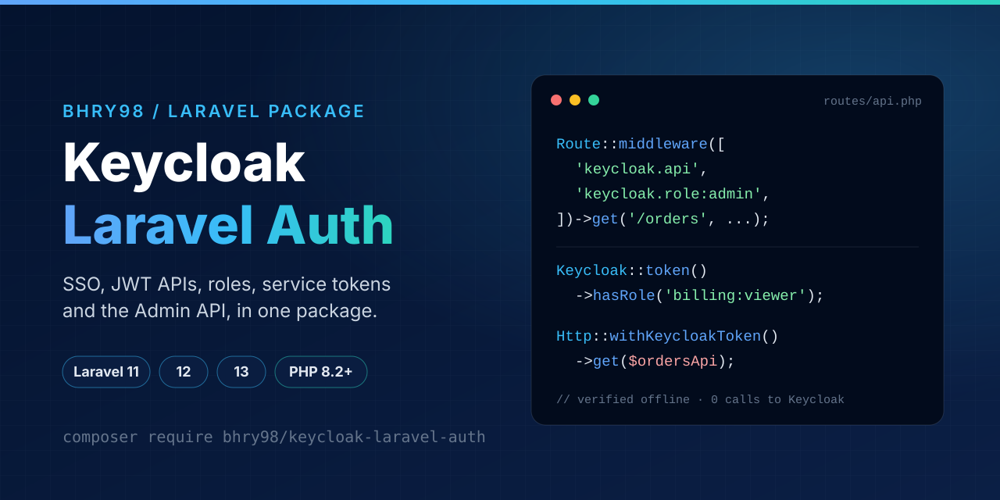
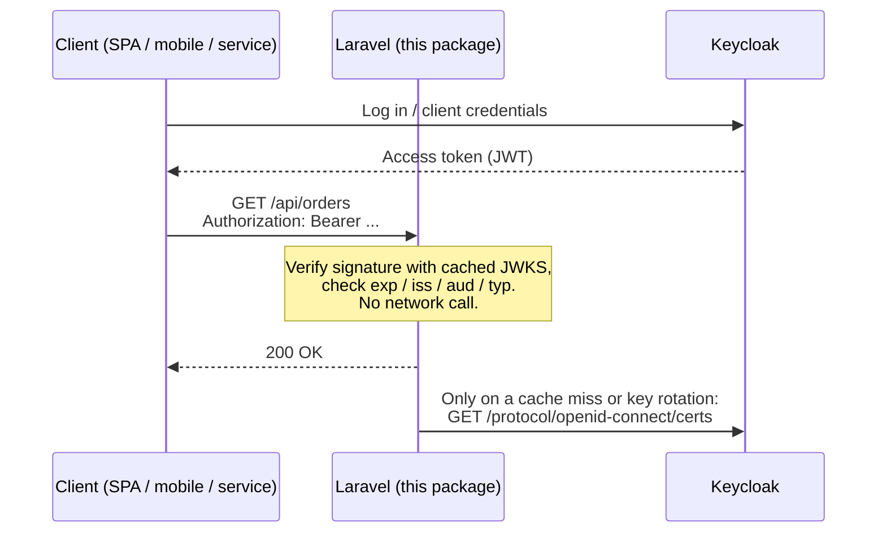

# Keycloak Laravel Auth



[:fontawesome-brands-github: GitHub](https://github.com/bhry98/keycloak-laravel-auth){ .md-button }
[:simple-packagist: Packagist](https://packagist.org/packages/bhry98/keycloak-laravel-auth){ .md-button }
[Get started :material-arrow-right:](installation.md){ .md-button .md-button--primary }

A complete **Keycloak** integration for **Laravel 11, 12 and 13**. It covers what a backend usually needs from
an identity provider: browser single sign-on, authenticating API calls, roles and permissions, calling other
services, and managing users. All of it goes through one facade.

```php
// Protect an API: the token is verified offline, no call to Keycloak
Route::middleware(['keycloak.api', 'keycloak.role:admin'])->get('/orders', OrderController::class);

// Read the current token anywhere
Keycloak::token()->hasRole('billing:invoice-viewer');

// Call another microservice with a cached service-account token
Http::withKeycloakToken('api')->get('https://orders.internal/api/orders');

// Manage users, roles and groups
$id = Keycloak::users()->create(['username' => 'jane', 'email' => 'jane@example.com', 'password' => 'S3cret!']);
Keycloak::users()->assignRealmRoles($id, ['editor']);
```

## Why this package

- **Fast by design.** Access tokens are verified offline against the realm's public keys, which are cached
  in your cache store *and* in memory. A protected API request makes **no network call**. A token is
  verified once per process, admin and service tokens are reused for their real lifetime, and
  provisioning skips the database write while a user's claims are unchanged.
- **Secure defaults.** It checks the signature, `exp`/`nbf` with leeway, issuer, audience and token type, and
  only accepts allow-listed algorithms, so `none` and HMAC tokens are rejected. Key rotation is picked up
  automatically. The browser login uses PKCE and regenerates the session.
- **Everything a backend needs.** Browser SSO, a `keycloak` auth guard, role, scope, group and UMA
  permission checks, the main OIDC grants, token exchange, and the Admin REST API (users, roles, groups,
  clients, events).
- **Works with Laravel's own tools:** guards, `$request->user()`, middleware, gates, `@can`, Blade
  directives, events, the `Http` client and Artisan.
- **Built to test.** `Keycloak::fake()` signs real RS256 tokens locally, so your feature tests need no
  Keycloak server.
- **Backward compatible** with the 1.x services, middleware and facade.

## Features at a glance

| Area | What you get |
|---|---|
| [Web SSO](web-sso.md) | Authorization code + PKCE login, silent token refresh, RP-initiated logout, `keycloak.web` middleware |
| [API authentication](api-authentication.md) | `keycloak.api` middleware, `keycloak` guard driver, stateless or database-backed users, microservice-friendly |
| [Authorization](authorization.md) | Realm and client roles, scopes, groups, UMA permissions, gates, Blade directives, `HasKeycloakRoles` |
| [OIDC & service tokens](oidc.md) | Password, refresh, client-credentials, code, token exchange, introspection, userinfo, logout, `Http::withKeycloakToken()` |
| [Admin API](admin-api.md) | Users, realm roles, client roles, groups, clients, sessions, events, required-action e-mails, lazy pagination |
| [Testing & tooling](testing.md) | Fake tokens, `actingAsKeycloakUser()`, Artisan commands, events |

## Compatibility

| Laravel | PHP       | Status              |
|---------|-----------|---------------------|
| 13.x    | 8.3 – 8.5 | :material-check: supported |
| 12.x    | 8.2 – 8.5 | :material-check: supported |
| 11.x    | 8.2 – 8.5 | :material-check: supported (Laravel 11 itself no longer gets security fixes) |

CI runs the test suite against every combination, with both the lowest and the latest dependency versions.
Works with any Keycloak version that has the `/realms/{realm}` URL layout (Keycloak 17+, Quarkus
distribution).

## How it works



## Where to go next

| Page | What's in it |
|---|---|
| [Installation](installation.md) | Composer, publishing, `.env`, and setting up the clients in Keycloak. |
| [Configuration](configuration.md) | Every config option: guards, token validation, web, provisioning, cache, HTTP. |
| [Web SSO](web-sso.md) | Browser login, session refresh, logout, Filament / admin panels. |
| [API authentication](api-authentication.md) | Bearer-token APIs, the auth guard, users, Docker and Kubernetes issuers. |
| [Authorization](authorization.md) | Roles, scopes, groups, UMA permissions, gates and Blade. |
| [OIDC & service tokens](oidc.md) | Calling Keycloak's endpoints and other services. |
| [Admin API](admin-api.md) | Managing users, roles, groups and clients. |
| [Testing & tooling](testing.md) | Test helpers, Artisan commands and events. |
| [Upgrade guide](upgrade.md) | Moving from 1.x to 2.x. |

!!! tip "More packages"
    Looking for something else? Browse [all bhry98 packages](../index.md).
