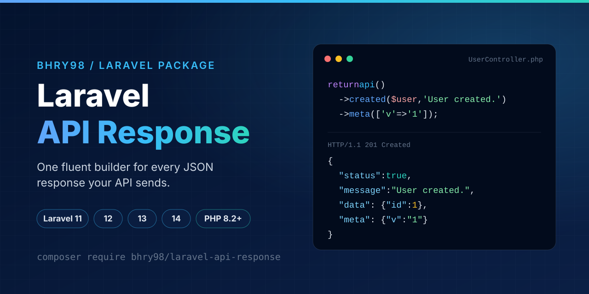

# Laravel API Response



[:fontawesome-brands-github: GitHub](https://github.com/bhry98/laravel-api-response){ .md-button }
[:simple-packagist: Packagist](https://packagist.org/packages/bhry98/laravel-api-response){ .md-button }
[Get started :material-arrow-right:](installation.md){ .md-button .md-button--primary }

A fluent, extensible, highly configurable API response toolkit for **Laravel 11, 12, 13 and 14**. It works with zero
configuration, and you can customize it as far as you need.

```php
return api()->created($user);

return api()
    ->success()
    ->message('User created.')
    ->data($user)
    ->meta(['foo' => 'bar'])
    ->headers(['X-Foo' => 'bar'])
    ->send();
```

## Why this package

- **One fluent builder** (`api()` / `ApiResponse`) for every response your API sends: success, error, validation,
  pagination, resources.
- **Configurable envelope**: rename keys, wrap the payload, switch between `default`/`minimal`/`mobile`/`jsonapi`
  presets, or write your own formatter.
- **Automatic data detection**: pass an Eloquent model, a `Collection`, a `JsonResource`, a paginator, or a plain
  array/DTO, and it's normalized the same way every time.
- **Opt-in middleware for cross-cutting concerns**: rate limiting, request/response audit logging, and
  `Accept-Language`-aware locale resolution, all driven by config.
- **Hooks, events, macros and presets** for every extension point, so you never need to fork the package.
- **Fully backward compatible** with the pre-2.0 `BResponseSuccess`/`BResponseError`/... API.

## Compatibility

| Laravel | PHP       | Status                                                                        |
|---------|-----------|-------------------------------------------------------------------------------|
| 14.x    | 8.4 to 8.5 | :material-flask: tested against `dev-master` ahead of its release             |
| 13.x    | 8.3 to 8.5 | :material-check: supported                                                    |
| 12.x    | 8.2 to 8.5 | :material-check: supported                                                    |
| 11.x    | 8.2 to 8.5 | :material-check: supported (Laravel 11 itself no longer gets security fixes)  |

CI runs the full test suite on every combination above, with both the lowest and the latest dependency versions.

## Where to go next

| Page                              | What's in it                                                                                                                                                                                      |
|-----------------------------------|---------------------------------------------------------------------------------------------------------------------------------------------------------------------------------------------------|
| [Installation](installation.md)   | Composer install, publishing config/lang/migrations, requirements.                                                                                                                                |
| [Responses](responses.md)         | Building and sending responses: basic usage, ready-made shortcuts, templates, macros, automatic data detection, pagination, resources.                                                            |
| [Customization](customization.md) | Presets & envelope shape, global metadata, debug mode, versioning, localization, **rate limiting**, **audit logging**, hooks, events, exception handling, testing helpers, extending the package. |
| [Upgrade Guide](upgrade.md)       | What changed in each release, backward compatibility with the pre-2.0 API, and the package's internal architecture.                                                                              |

## Quick example

```php
use Bhry98\LaravelApiResponse\Facades\ApiResponse;

return api()
    ->success()
    ->message('User created.')
    ->data($user)
    ->send();

// identical, via the facade
return ApiResponse::success()->message('User created.')->data($user)->send();
```

Default JSON shape:

```json
{
    "status": true,
    "message": "User created.",
    "data": {
        "id": 1
    }
}
```

!!! tip "More packages"
    Looking for something else? Browse [all my packages](../index.md).
