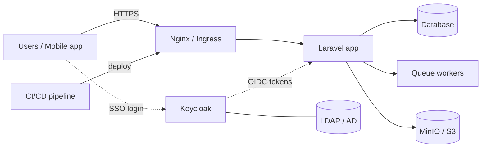

Projects

# Selected work

Business platforms I've designed and built. Most are private systems for organizations, so
details are kept general — I'm happy to walk you through the architecture and a demo on a call.

-   :material-office-building-cog-outline:{ .lg } **Enterprise ERP System**

    ---

    EnterpriseProduction

    A modular ERP that brings core business operations into one place — with department-level
    permissions, approval workflows and full audit trails.

    
<code>Laravel</code><code>Filament</code><code>RBAC</code><code>REST API</code>

-   :material-face-agent:{ .lg } **Service Desk Platform**

    ---

    IT Operations

    Ticketing with categories, priorities, SLAs, assignment and escalation rules, so support
    teams always know what to work on next.

    
<code>Laravel</code><code>Livewire</code><code>Keycloak SSO</code>

-   :material-account-group-outline:{ .lg } **HR Management System**

    ---

    People

    Employee records, leave and attendance, onboarding workflows and employee self-service
    requests.

    
<code>Laravel</code><code>Filament</code><code>LDAP / AD</code>

-   :material-handshake-outline:{ .lg } **CRM**

    ---

    Sales

    Customers, contacts, opportunities and activities in a single pipeline view, with
    reporting for managers.

    
<code>Laravel</code><code>Livewire</code><code>MySQL</code>

-   :material-account-cog-outline:{ .lg } **Self-Service Portal**

    ---

    Employees

    A single portal where users submit and track requests, reset access and find answers —
    signed in with company SSO.

    
<code>Laravel</code><code>OpenID Connect</code><code>Keycloak</code>

-   :material-robot-outline:{ .lg } **AI Dashboard**

    ---

    Analytics

    A dashboard that surfaces insights and automates routine analysis on top of business data.

    
<code>Laravel</code><code>AI APIs</code><code>Charts</code>

-   :material-book-open-page-variant-outline:{ .lg } **Knowledge Base Platform**

    ---

    Documentation

    Searchable articles, categories and permissions so teams can document processes and help
    users help themselves.

    
<code>Laravel</code><code>Full-text search</code><code>RBAC</code>

-   :material-package-variant-closed:{ .lg } **Open-source Laravel packages**

    ---

    Open SourcePublic

    API responses, users & RBAC, Keycloak auth, dynamic enums and starter kits —
    [see all packages](packages.md).

    
<code>PHP</code><code>Laravel 11–13</code><code>Composer</code>

## Typical architecture

Most of these systems share a proven foundation I can reuse for your project:

## Want something similar?

I can build a tailored version of any of these for your organization.

[Discuss your project :material-arrow-right:](contact.md){ .md-button .md-button--primary }

