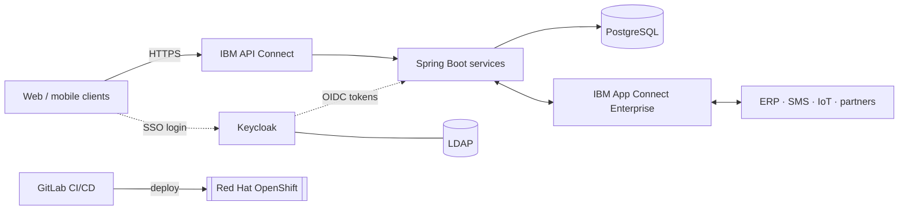

Projects

# Selected work

Platforms I've built, integrated and operated. Most are private systems for organizations,
so details stay general. I'm happy to walk you through the architecture on a call.

-   :material-office-building-cog-outline:{ .lg } **ERP Platform**

    ---

    Valleysoft2024 - Present

    Backend services, deployment and integration for a modular ERP. Centralized SSO with
    Keycloak, integrations with SMS providers and IoT access-control systems, and secure
    service-to-service communication.

    
<code>Java</code><code>Spring Boot</code><code>Angular</code><code>PostgreSQL</code><code>Keycloak</code>

-   :material-transit-connection-variant:{ .lg } **Enterprise API &amp; Integration**

    ---

    Integration

    API contracts, request/response transformations and secure application-to-application
    integration, connecting internal applications, ERP modules and external services.

    
<code>IBM CP4I</code><code>App Connect</code><code>API Connect</code><code>OAuth 2.0</code>

-   :simple-redhatopenshift:{ .lg } **Integration Platform Operations**

    ---

    Platform

    Administering IBM Cloud Pak for Integration environments: runtime components,
    deployments, configuration, certificates and production troubleshooting.

    
<code>OpenShift</code><code>CP4I</code><code>Linux</code><code>GitLab CI/CD</code>

-   :material-shield-account-outline:{ .lg } **Centralized Identity &amp; SSO**

    ---

    Security

    Keycloak-based single sign-on across enterprise applications, with secure authentication
    and authorization flows and LDAP integration.

    
<code>Keycloak</code><code>OpenID Connect</code><code>LDAP</code><code>JWT</code>

-   :material-account-group-outline:{ .lg } **Business Modules**

    ---

    Valleysoft

    HR, CRM, Self-Service and Service Desk modules built as part of a larger enterprise suite.

    
<code>REST APIs</code><code>PostgreSQL</code><code>RBAC</code>

-   :material-gift-outline:{ .lg } **Mora Electric: Redeem Points App**

    ---

    Client project2025

    A loyalty application that lets customers collect and redeem points.

    
<code>Backend APIs</code><code>Integration</code>

## Typical architecture

Most of the systems I work on share a foundation like this:

## Questions about this work?

Curious how something here was built, or want to talk tech? Feel free to reach out.

[Contact me :material-arrow-right:](contact.md){ .md-button .md-button--primary }

